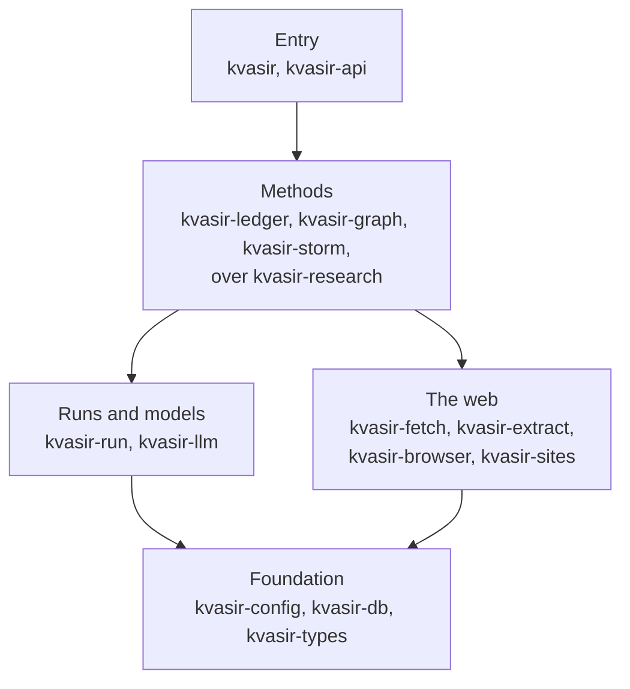
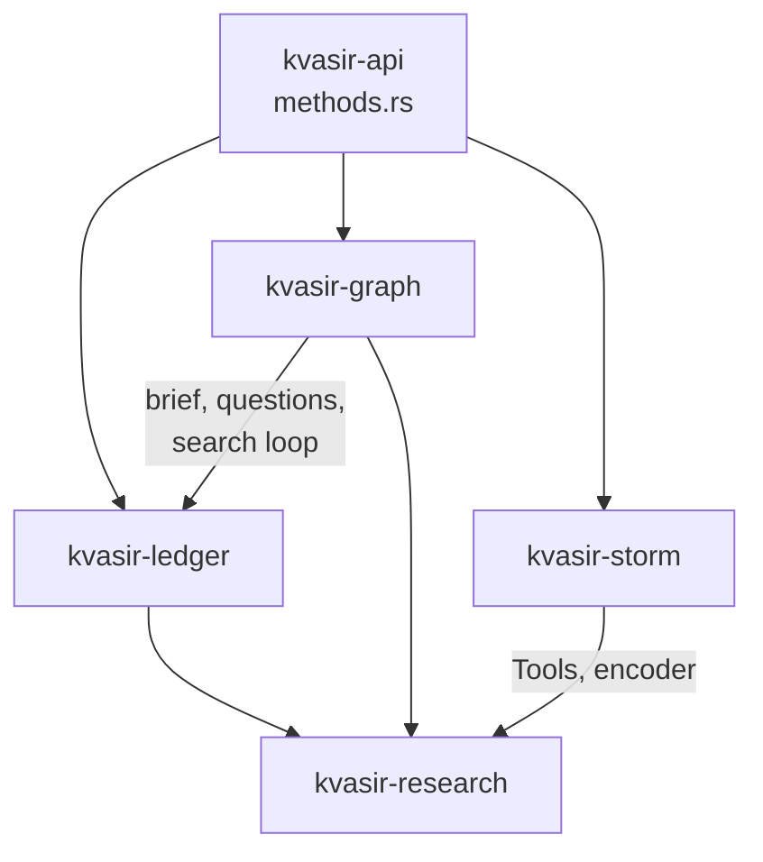

# Crates

The workspace is one crate per concern. Each crate's `README.md` says what it holds and lists its
modules; it is also the crate's rustdoc page. How the service fits together at run time is in
[`docs/architecture.md`](../docs/architecture.md).

## Layers

An arrow means the crates in one box depend on those in the next. A crate may skip a layer, never
point back up: the web crates know nothing of models or runs, and the foundation knows nothing of
the web.

| Layer | Crate | Holds |
| --- | --- | --- |
| Entry | [`kvasir`](kvasir) | The binary: `serve`, `eval`, `openapi` and `pdf-text`. |
| | [`kvasir-api`](kvasir-api) | The axum routes, the shared state, and `Method`, the set of research methods. |
| Methods | [`kvasir-research`](kvasir-research) | The steps the methods share: search, reading, recall, writing, verification, rendering. |
| | [`kvasir-ledger`](kvasir-ledger) | The `ledger` method: a brief split into questions, searched one at a time. |
| | [`kvasir-graph`](kvasir-graph) | The `graph` method: questions explored best first, each raising the next. |
| | [`kvasir-storm`](kvasir-storm) | The `storm` method: STORM, translated from `knowledge_storm`. |
| Runs and models | [`kvasir-run`](kvasir-run) | Runs: their state, stages, usage, slots and live followers. |
| | [`kvasir-llm`](kvasir-llm) | Signatures, model roles, and `Gateway`, the OpenAI-compatible client. |
| The web | [`kvasir-fetch`](kvasir-fetch) | Reading a page: the address guard, robots.txt, politeness and `pages.db`. |
| | [`kvasir-extract`](kvasir-extract) | What a page says: its article as markdown, its links, PDF text. No network. |
| | [`kvasir-browser`](kvasir-browser) | A page as Chromium builds it, behind the `chromium` feature. |
| | [`kvasir-sites`](kvasir-sites) | Source trust and site icons. |
| Foundation | [`kvasir-config`](kvasir-config) | `Settings`, from the environment and `kvasir.db`. |
| | [`kvasir-db`](kvasir-db) | Opening and migrating the SQLite files, and running their work off the runtime. |
| | [`kvasir-types`](kvasir-types) | The request, result and run types the API serves. |
| Tests only | [`kvasir-testkit`](kvasir-testkit) | A scripted model, and the golden check of a signature. A dev-dependency only. |

## Methods

A research method is a crate of its own, and `kvasir-api` picks one per run. Solid arrows are
dependencies on another crate's code.

- `ledger` and `graph` read pages through the shared steps, and write and verify a cited report.
  `graph` reuses the ledger's brief, question list and search loop, and picks the next question by
  proof numbers instead. How each works is in [`docs/research.md`](../docs/research.md).
- `storm` reads search snippets only, so it takes no more from `kvasir-research` than `Tools` and
  the encoder. How it differs from upstream is in [`docs/storm.md`](../docs/storm.md).

Which steps each method calls is in the [`kvasir-research` README](kvasir-research/README.md).

### Adding a method

1. Create `crates/kvasir-<name>`, depending on `kvasir-research`. The workspace takes in every
   directory under `crates/`.
2. Add `kvasir-<name> = { path = "crates/kvasir-<name>" }` to `[workspace.dependencies]` in the
   root `Cargo.toml`, and `kvasir-<name>.workspace = true` to `crates/kvasir-api/Cargo.toml`.
3. Add its options type to `crates/kvasir-types/src/requests.rs`, beside `LedgerOptions`.
4. Add a `Method` variant in `crates/kvasir-api/src/methods.rs`, and its arm in each function
   there. `Method` is a closed enum, so `cargo check` names every match still missing the variant.
5. Run `cargo test --workspace`.
