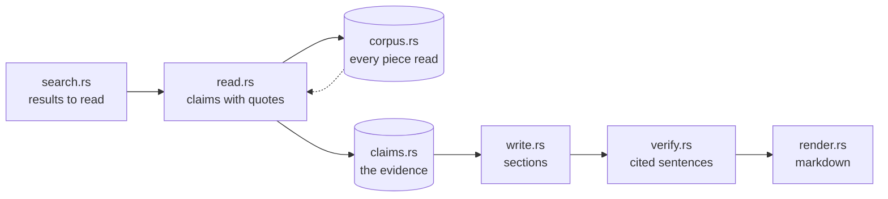

# kvasir-research

The research steps the methods share: searching, reading pages into claims, recalling what was
read, writing sections, and checking what was written against its evidence.

A method owns its loop: what to search for next, and when to stop. This crate owns each step the
loop calls. How the `ledger` method strings them together, and why each is shaped as it is, is in
[`docs/research.md`](../../docs/research.md).

## How a report is built from the steps

Solid arrows carry data from one step to the next. The dotted arrow is recall: a later read takes
pieces from pages an earlier search already found.

`read.rs`, `verify.rs` and `corroborate.rs` ask `ground.rs` when a grounding checker is configured.
`corroborate.rs` runs on the claims with the `corroborate` or `contradict` option.

| Step | `ledger` | `graph` | `storm` |
| --- | --- | --- | --- |
| `search`, `read`, `corpus`, `claims` | yes | yes | no: snippets only |
| `write`, `verify`, `render` | yes | yes | no: its own writing stages |
| `corroborate` | yes | yes | no |
| `Tools`, `encoder` | yes | yes | yes |

## Modules

Under `src/`.

| Module | Holds |
| --- | --- |
| `lib.rs` | `Tools`, what every step calls: models by role, the encoder, search, pages and sources. |
| `search.rs` | Searching, skipping what the run already read, and choosing which results to read. |
| `read.rs` | Reading pages into claims, each with a quote that is on its page. |
| `corpus.rs` | Every piece of every page a run read, with its vector, for recall. |
| `claims.rs` | The evidence a run gathers, and lookups over it by meaning. |
| `encoder.rs` | Embeddings, and how close two are. |
| `write.rs` | One section of a report from the claims closest to it, and the summary. |
| `style.rs` | Removing from written prose the tics a model adds. |
| `verify.rs` | Checking each cited sentence against the quotes it cites. |
| `corroborate.rs` | Which claims other sites agree with or contradict. |
| `ground.rs` | Whether a document supports a claim, asked of a grounding checker. |
| `render.rs` | The report as markdown, with claim ids as numbered sources. |
| `text.rs` | Matching text word for word, as quotes and names are matched. |
| `clarify.rs` | The questions worth asking before a run starts. |
| `signatures.rs` | The signatures more than one method uses. |
| `prompts/` | The instructions of those signatures. |
