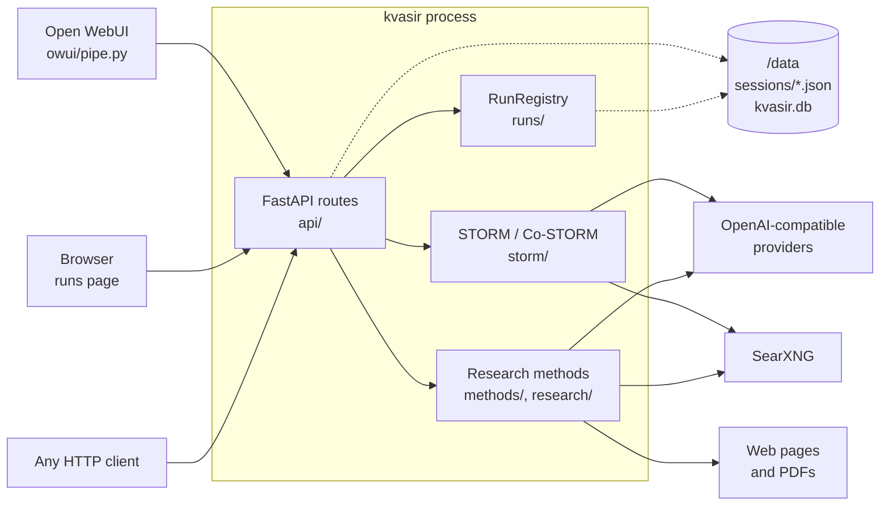
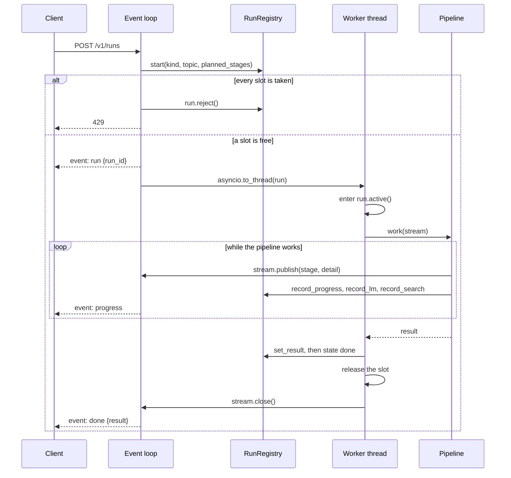
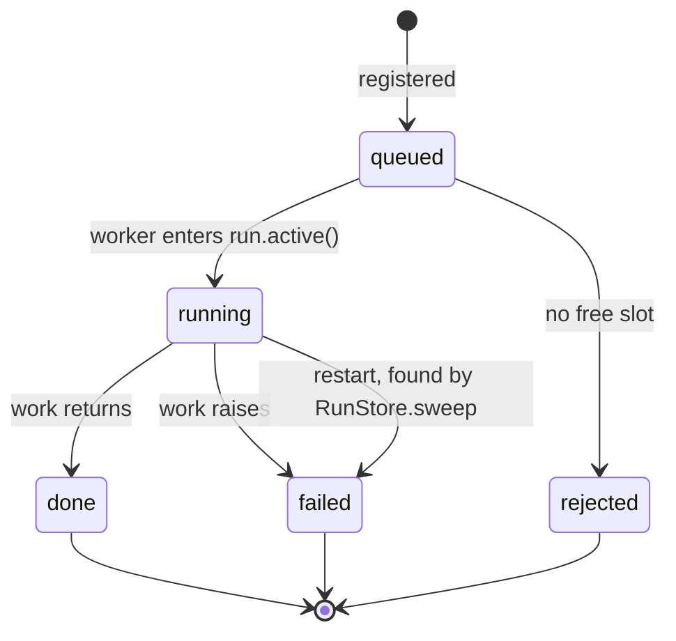
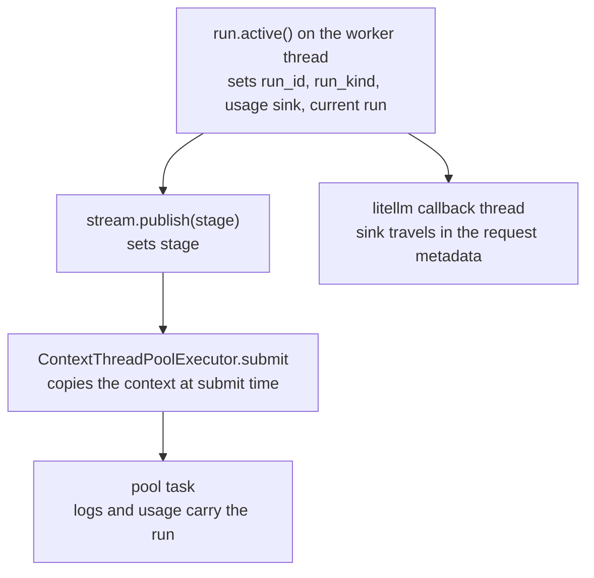
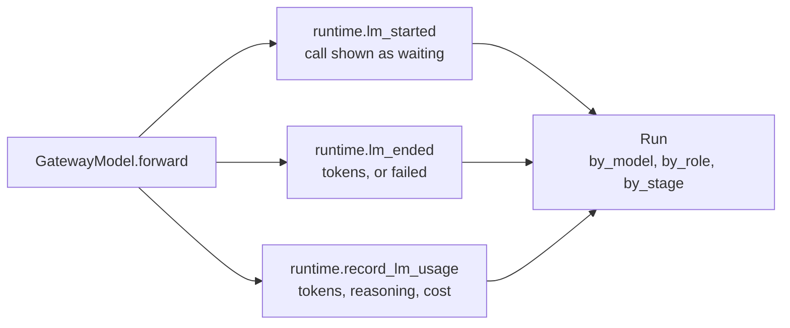
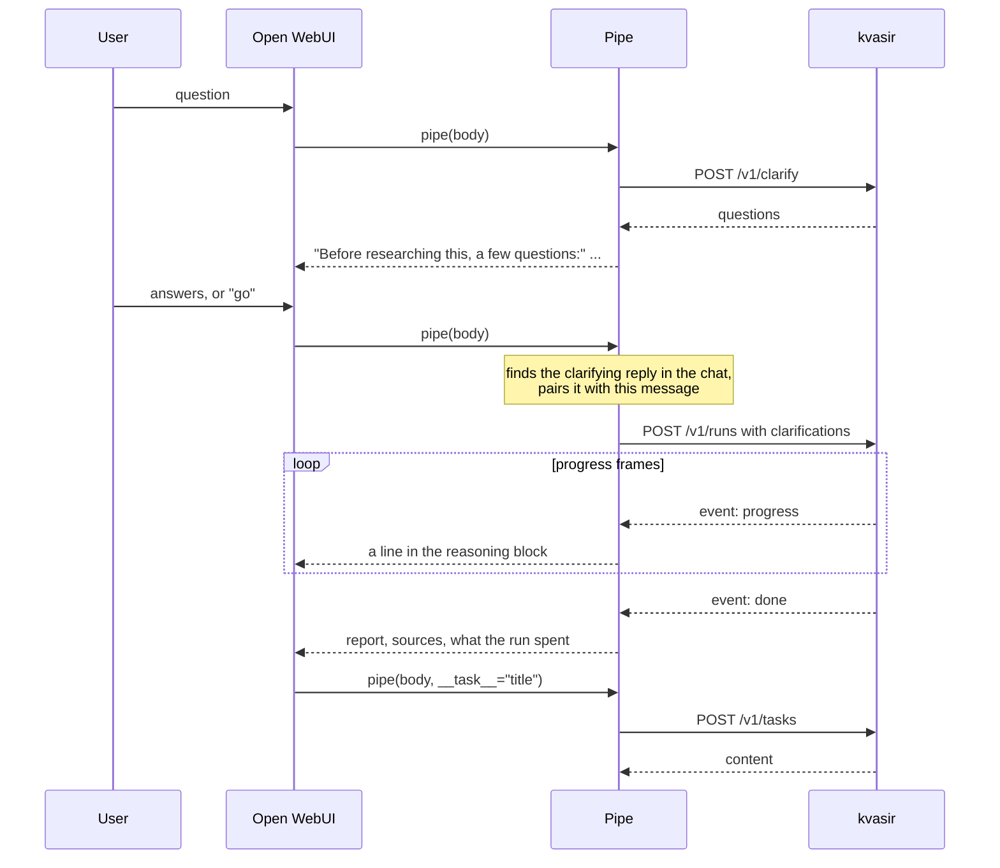

# Architecture

How kvasir is put together, and why each part is the way it is. Read this before changing how runs
are started, streamed, accounted for or stored. The research pipeline has its own page,
[`research.md`](research.md); changes to the vendored STORM fork are recorded in
[`fork-notes.md`](fork-notes.md). How to run and configure the service is in the
[README](../README.md).

## The pieces

kvasir is one Python process. It holds no state that a restart must recover except Co-STORM
sessions, and optionally a run history. Every model and embedding call goes to an
OpenAI-compatible provider, and every search goes to one SearXNG instance.

Solid arrows are requests kvasir makes or serves. Dotted arrows are files it writes.

| Module | Holds |
| --- | --- |
| `api/` | The app and its routers: runs, tasks and Co-STORM sessions. `api/streaming.py` holds `streamed`, which turns blocking work into an SSE response. |
| `__main__.py` | The entry point. Configures logging before uvicorn starts. |
| `config.py` | `Settings`, resolved once from the environment over `kvasir.toml`. |
| `runners.py` | Builds every model, the encoder and the retriever from settings, one model per role. |
| `schemas/` | The request, result and run models the API serves. |
| `runs/progress.py` | `ProgressStream`, and the callback handlers that turn STORM's callbacks into progress events. |
| `runs/` | `Run` (`run.py`) and `RunRegistry` (`registry.py`): state, stages, usage and live followers for each run. `store.py` is the optional SQLite history. |
| `sessions.py` | Co-STORM session files. |
| `conversation.py` | Drives one Co-STORM operation. |
| `research/` | The steps every research method shares: search, reading, verification, writing, rendering. See [`research.md`](research.md). |
| `methods/` | The methods `POST /v1/runs` runs, listed in `METHODS`. Each is a `Method` (`methods/base.py`): its options, stages, configured defaults and run. `methods/ledger/` is the research pipeline, `methods/graph/` explores the questions findings raise over the same steps, `methods/storm/` drives STORM. See [`methods-plan.md`](methods-plan.md). |
| `storm/` | The vendored, modified `knowledge_storm`. See [`fork-notes.md`](fork-notes.md). |
| `static/` | The runs page, built from `web/` by `pnpm build` and not committed. `GET /` answers 503 until it is built. |

## Three ways to produce something

| Route | Engine | Run kind | Output |
| --- | --- | --- | --- |
| `POST /v1/runs` with `ledger` | `methods.ledger.method.run_research` | `ledger` | A report answering a question, ranking or comparing options when asked. |
| `POST /v1/runs` with `graph` | `methods.graph.method.run_graph` | `graph` | A report answering a question, one section per branch explored. |
| `POST /v1/runs` with `storm` | STORM, `methods.storm.method.run_article` | `storm` | A Wikipedia-style article about a topic. |
| `POST /v1/session` and its sub-routes | Co-STORM, `conversation.*` | `costorm` | A turn-based round table, and a report from it. |

STORM and Co-STORM are upstream's work, kept close to upstream. The research pipeline is kvasir's
own, written because STORM takes no instructions, does not compare or rank, and its prompts ask for
an encyclopedia page. It lives outside the fork so it is typed, linted and checked by `mypy` like
the rest of the service.

Two routes are deliberately not runs: `POST /v1/tasks` and `POST /v1/clarify`. Each is one
fast-model call. Neither registers a run nor takes a slot. `/v1/tasks` exists because Open WebUI
asks the chat's own model for a title, tags and follow-up prompts; answered as runs, those would
queue behind, or be refused by, the run they describe. Clarifying happens before the user has
decided to start a run, so it must not take one.

## A run, from request to result

Every run route goes through `streamed` in `api/streaming.py`. The work itself is blocking: dspy, litellm
and the STORM fork are synchronous, and a run takes minutes. So the work runs in a worker thread,
and the response is served from the event loop. A `ProgressStream` connects the two: an asyncio
queue the worker writes to through `call_soon_threadsafe`.

The order inside `streamed` is deliberate:

1. **The run is registered before the slot is claimed.** A refused request then shows up on the
   runs page as `rejected`, rather than as a 429 with nothing behind it. Saturation is when the
   registry is most useful.
2. **Saturation is refused, not queued.** A queued run would outlast any sensible client timeout.
   The slots are a `threading.BoundedSemaphore` acquired without blocking, so the check is safe on
   the event loop.
3. **The `run` frame comes first.** A client that stops reading can still follow the run at
   `/v1/runs/{id}/events`.
4. **The result is set before the run ends.** The closing snapshot a follower receives already
   carries it.

A disconnecting client does not stop the work: there is no way to cancel a STORM run, so the
thread carries on to completion. The worker thread releases the slot when the work ends, not when
the response does, so a client that leaves mid-run cannot let more runs start than
`KVASIR_RUNS_MAX_CONCURRENT` allows. A client that leaves before the work starts frees the slot at
once.

### Run states

`failed` after a restart only exists with `KVASIR_RUNS_STORE=sqlite`. A memory-only registry
forgets the run instead.

### Following a run

`GET /v1/runs/{id}/events` serves any run held in memory, including one another client started. It
registers a watcher before taking the snapshot, so a run that ends in between still delivers its
end. Then it sends:

| Frame | When |
| --- | --- |
| `snapshot` | First, with everything so far, and again last. |
| `progress` | Each progress event. |
| `status` | After each progress event, and every 2 seconds in between (`STATUS_INTERVAL_SECONDS`). |

The idle `status` exists because tokens are spent between progress events, and STORM's polish
stage publishes none for minutes. A run only the SQLite store holds has ended, so its stream is
one snapshot.

## Threads, and how a run stays identifiable

A run fans out. STORM nests thread pools, and the research pipeline fetches pages in a pool. Code
deep inside the fork must still know which run it is working for, to log under the right
`run_id` and to charge the right run for tokens. Passing a run object down through upstream's
call graph would touch most of the fork, so kvasir uses contextvars instead.

- `Run.active()` enters `logs.run_context`, `runtime.record_usage_into` and the current-run
  contextvar on the worker thread, not on the event loop, so they are scoped to this run.
- `ProgressStream.publish` sets the stage, because a progress event is exactly when the stage is
  known to change.
- `storm.runtime.ContextThreadPoolExecutor` copies the context at submit time, not at
  construction, so a task sees the stage the run was in when the work was handed over.
- Embedding usage is reported by a litellm callback on litellm's own thread, which starts with an
  empty context. `runtime.current_usage_sink()` reads the sink in the caller's thread so it can
  travel with the request.

Concurrency is bounded process-wide. `KVASIR_MAX_THREADS` sizes every pool, and each outbound
search or page request takes a permit from one semaphore, `runtime.fetch_slot()`. Upstream sized
each pool level independently, which multiplied out to hundreds of simultaneous requests against a
self-hosted provider. Fetches are the innermost level and wait on nothing, so holding a permit
cannot deadlock against the pools above.

## Models and accounting

`runners.py` builds one `GatewayModel` per role, from three tables: `_STORM_ROLES`,
`_COSTORM_ROLES` and `_RESEARCH_ROLES`. Each entry names a tier, fast or strong, and a token
budget. The rule for tiers: the fast model handles many small calls (simulating conversation,
asking questions, extracting claims, checking sentences), and the strong model writes what a reader
sees and makes the judgements that steer a run.

Every model is a chat model on its provider at temperature 1.0 and `top_p` 0.9. STORM's
multi-perspective research needs its simulated conversations to diverge, which temperature 0 would
suppress. `api_key` and `api_base` are passed to each model explicitly and never exported to the
environment, so no default can reach `api.openai.com`.

`GatewayModel.forward` in `storm/lm.py` is the one place where the response, the role and the
run's usage sink are all in scope. Per attempt, it reports:

A call counts toward the stage the run is in when it finishes. Cost is read from what the
response reports, in the order the README's [Watch what is running](../README.md#watch-what-is-running)
section gives.

Retrying is `forward`'s too, not litellm's. It retries only what a later attempt can fix (rate
limits, server errors, timeouts, transport errors) for up to 1000 seconds, because a run is minutes
of work and waiting out an outage costs less than losing it. A bad request or a context overflow
fails at once. The retry budget is a contextvar, so `/v1/tasks` and `/v1/clarify` cap it at
30 seconds (`TASK_RETRY_SECONDS`): nobody waits out an outage for a chat title.

## What is kept, and where

| Data | Where | Lifetime | Why there |
| --- | --- | --- | --- |
| Runs | Memory, in `RunRegistry` | The `KVASIR_RUNS_MAX` most recent, until restart | Runs are observation, not state: nothing resumes from one. |
| Run history | `$KVASIR_DATA_DIR/kvasir.db`, with `KVASIR_RUNS_STORE=sqlite` | `KVASIR_RUNS_TTL_DAYS` and `KVASIR_RUNS_MAX` | For debugging the service. A client such as Open WebUI keeps its own record of every answer. |
| Model call content and search results | With its run, in memory and in `kvasir.db`, with `KVASIR_RUNS_KEEP_CALL_CONTENT=true` | As long as its run | Prompts and answers can hold what a user asked, so keeping them is opt-in. Search results follow the same setting. |
| Co-STORM sessions | `$KVASIR_DATA_DIR/sessions/<id>.json` | `KVASIR_SESSIONS_TTL_HOURS`, swept at startup | A round table spans many requests and must survive a restart. |
| STORM scratch | A temporary directory under `/tmp` | One run | STORM writes its output as files; `methods/storm/method.py` reads them back and removes the directory. |
| Research evidence | The run's result | As long as the run | The `done` frame carries every claim, so nothing else needs storing. |

The SQLite store writes a run twice: when it starts, so a restart mid-run leaves a trace, and when
it ends. A run in progress is always read from memory. At startup, `RunStore.sweep` marks any run
still `queued` or `running` as `failed` with `interrupted by a restart`.

A session file is written to a sibling `.json.tmp`, flushed, fsynced and renamed, so a crash
mid-write leaves the previous session readable. Session ids come from the caller, so they are
checked against `[A-Za-z0-9][A-Za-z0-9_-]{0,127}` before reaching the filesystem. Nothing holds a
Co-STORM runner between requests: each operation loads the session, does one thing and saves it.
The models, encoder and retriever come from current settings, not from the file, so a config change
reaches the next turn of an existing session.

Expiry, of sessions and of stored runs, happens once at startup and, for runs, after each run ends.
There is no scheduler and no background task.

## Open WebUI

`owui/pipe.py` is one Pipe function exposing three models: `kvasir.research`, `kvasir.storm` and
`kvasir.co-storm`. It keeps no state of its own: it uses only aiohttp, pydantic and the standard
library, which Open WebUI already ships, and finds everything it needs by reading the chat back.

- A clarifying reply opens with `CLARIFY_OPENER`. The next message is read as its answer, and `go`
  starts without one.
- Progress goes into a reasoning block, which Open WebUI renders collapsed and times itself, so a
  message running for many minutes says what it is doing.
- STORM ignores conversation history. A follow-up starts a new run, so the pipe asks first when
  `CONFIRM_RERUN` is on.
- Co-STORM keys its session by the chat id, so one chat is one round table.

The valve reference is in [`owui/README.md`](../owui/README.md).

## Decisions

Each row is a choice someone changing kvasir is likely to question, and the reason it stands.

| Decision | Reason |
| --- | --- |
| No authentication, and none to be added here. | The service is reached over a private network behind the consumer's own policy layer. `api/__init__.py` says so at the top. |
| Every provider is OpenAI-compatible, reached through dspy only. | One wire protocol, with the endpoint and key per provider in `[provider.<name>]`. A gateway in front gives one place for credentials, routing, caching and pricing. litellm is not a direct dependency; dspy uses it as its transport. |
| No response cache in kvasir. | The provider or a gateway caches. A second cache is a second place to invalidate, and upstream's cache, opened under the home directory at import, failed under a read-only root. |
| A model is `<provider>/<name>`, and an unknown provider is refused at startup. | The provider picks the endpoint and key; dspy is given `openai/<name>`. Guessing a provider would hide a misconfiguration. |
| Configuration is read once, at startup, and a bad value stops it. | A container that starts and fails on the first request is harder to diagnose than one that refuses to start. |
| `/healthz` checks nothing; `/readyz` checks the providers the models use and SearXNG without spending tokens. | A provider outage must not restart the pod. |
| Logs are one JSON object per line, each with `run_id`, `run_kind` and `stage`. | Runs interleave across threads, so lines must be separable by machine. `python -m kvasir` routes uvicorn's access log through the same handler. |
| The runs page is a Svelte app built at image build time, and loads nothing from another origin. | The image is read-only and may be offline. Markdown is only lexed, by `marked`, and Svelte writes every token as text, so nothing from a web page or a model is parsed as HTML. |
| `knowledge_storm` is vendored and modified. | Upstream is dormant, and most of the changes fix behaviour that produced a bad article rather than an error. See [`fork-notes.md`](fork-notes.md). |
