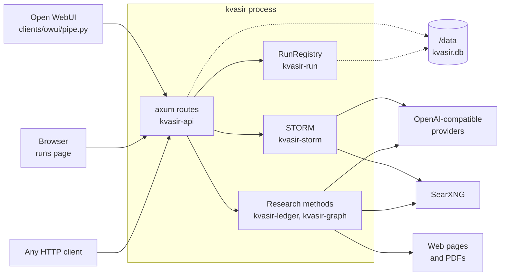
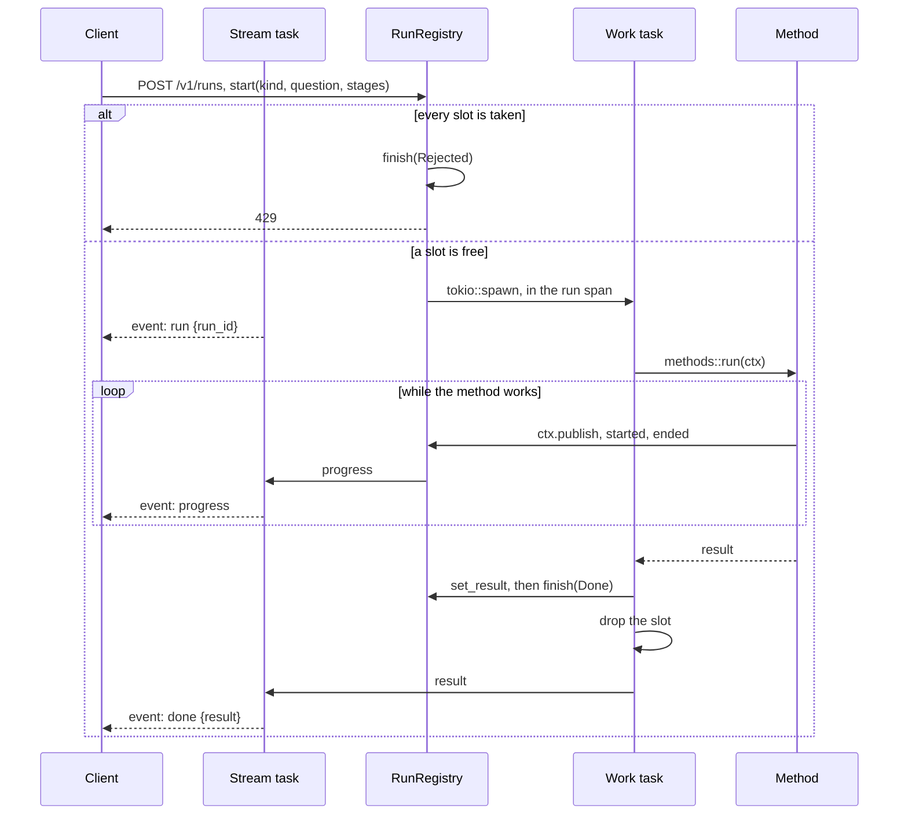
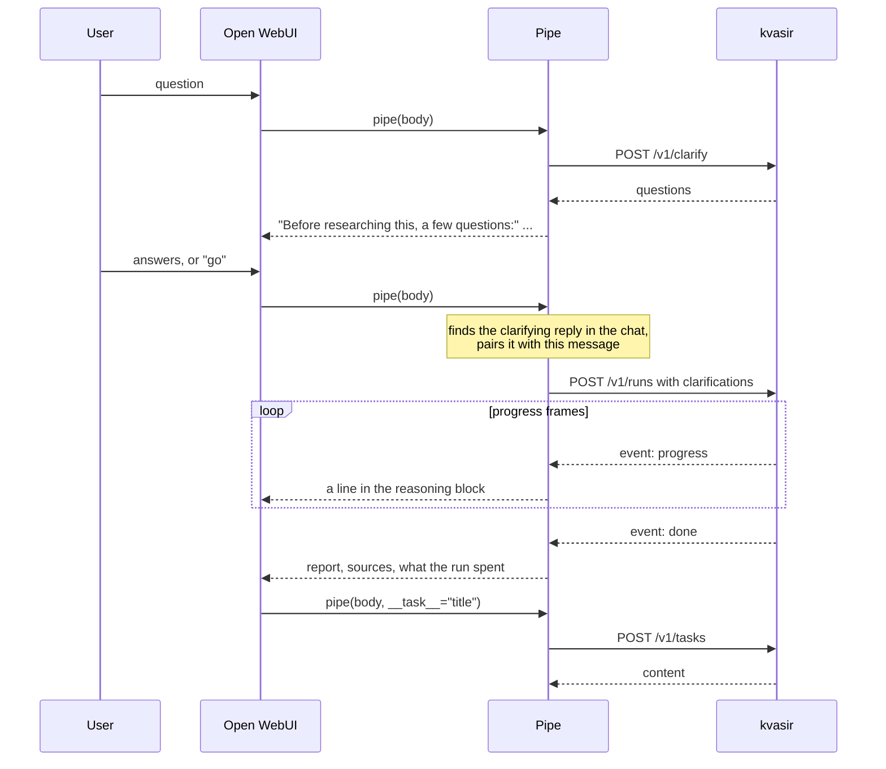

# Architecture

How kvasir is put together, and why each part is the way it is. Read this before changing how runs
are started, streamed, accounted for or stored. The research pipeline has its own page,
[`research.md`](research.md); how the STORM translation differs from upstream is recorded in
[`storm.md`](storm.md). How to run and configure the service is in the
[README](../README.md).

## The pieces

kvasir is one Rust process, `kvasir serve`. It holds no state that a restart must recover except, optionally, a
run history. Every model and embedding call goes to an
OpenAI-compatible provider, and every search goes to one SearXNG instance.

Solid arrows are requests kvasir makes or serves. Dotted arrows are files it writes.



The workspace is one crate per concern, under `crates/`. [`crates/README.md`](../crates/README.md)
lists them by layer, and each crate's own README lists its modules.

The runs page is built from `clients/web/` into `clients/web/dist` by `pnpm build` and not committed. A debug build
reads it from disk and a release build embeds it. `GET /` answers 503 until it is built.

## Three ways to produce something

| Route | Engine | Run kind | Output |
| --- | --- | --- | --- |
| `POST /v1/runs` with `ledger` | `kvasir_ledger::research` | `ledger` | A report answering a question, ranking or comparing options when asked. |
| `POST /v1/runs` with `graph` | `kvasir_graph::research` | `graph` | A report answering a question, one section per branch explored. |
| `POST /v1/runs` with `storm` | STORM, `kvasir_storm::run` | `storm` | A Wikipedia-style article about a topic. |

STORM is upstream's algorithm and prompts, kept close to upstream. The research pipeline is
kvasir's own, written because STORM takes no instructions, does not compare or rank, and its prompts
ask for an encyclopedia page.

Two routes are deliberately not runs: `POST /v1/tasks` and `POST /v1/clarify`. Each is one
fast-model call. Neither registers a run nor takes a slot. `/v1/tasks` exists because Open WebUI
asks the chat's own model for a title, tags and follow-up prompts; answered as runs, those would
queue behind, or be refused by, the run they describe. Clarifying happens before the user has
decided to start a run, so it must not take one.

## A run, from request to result

`start` in `crates/kvasir-api/src/runs.rs` serves `POST /v1/runs`. A run takes minutes, so the
work runs in a tokio task of its own, and a second task streams its events to the client. The run's
watcher connects the two.



The order inside `start` is deliberate:

1. **The run is registered before the slot is claimed.** A refused request then shows up on the
   runs page as `rejected`, rather than as a 429 with nothing behind it. Saturation is when the
   registry is most useful.
2. **Saturation is refused, not queued.** A queued run would outlast any sensible client timeout.
   `Slots::try_claim` never waits.
3. **The watcher subscribes before the work starts**, so no event is missed.
4. **The `run` frame comes first.** A client that stops reading can still follow the run at
   `/v1/runs/{id}/events`.
5. **The result is set before the run ends.** The closing snapshot a follower receives already
   carries it.

The method runs in a task spawned inside the work task, so a panic in it fails the run instead of
losing it. A disconnecting client does not stop the work: the work task carries on to completion,
and only the stream task ends. The work task drops the slot when the work ends, not when the
response does, so a client that leaves mid-run cannot let more runs start than
`runs.max_concurrent` allows.

### Run states


`failed` after a restart only exists with `runs.store` set to `sqlite`. A memory-only registry
forgets the run instead.

### Following a run

`GET /v1/runs/{id}/events` serves any run held in memory, including one another client started. It
registers a watcher before taking the snapshot, so a run that ends in between still delivers its
end. Then it sends:

| Frame | When |
| --- | --- |
| `snapshot` | First, with everything so far, and again last. |
| `progress` | Each progress event. |
| `status` | After each progress event, and every 2 seconds in between (`STATUS_INTERVAL`). |

The idle `status` exists because tokens are spent between progress events, and STORM's polish
stage publishes none for minutes. A run only the SQLite store holds has ended, so its stream is
one snapshot.

## Tasks, and how a run stays identifiable

A run fans out: STORM holds its conversations at once, and the research pipeline reads pages and
checks sentences at once. Code deep inside a method must still know which run it is working for,
to log under the right `run_id` and to charge the right run for tokens.

- The work task runs inside the `run` tracing span, with `run_id` and `run_kind`, so every line it
  logs carries both. A progress line carries `stage` too.
- Each method is handed a `RunCtx` (`crates/kvasir-run/src/ctx.rs`), which holds the run. It is the
  `Sink` every model call reports into, so a call is charged to the run that made it.
- A `RunCtx` is cloned for each piece of work it fans out to. The clone remembers the progress
  event published before the work was handed over, so a model call or a search names the event it
  belongs to, and the clone's own events do not move its parent's.

Concurrency is bounded process-wide. `KVASIR_MAX_THREADS` sets the width of every fan-out, and the
number of permits outbound page requests share in `kvasir-fetch`. Upstream STORM sized each pool
level independently, which multiplied out to hundreds of simultaneous requests against a
self-hosted provider. A page request first waits for its host, at most `HOST_CONCURRENCY` (2) at once
and paced by the host's interval, and only then takes a process permit
(`crates/kvasir-fetch/src/polite.rs`), so a slow host cannot starve fetches to every other one.

## Models and accounting

`crates/kvasir-llm/src/roles.rs` gives each role a tier, fast, strong or reason, and a token
budget: `RESEARCH` for the research methods, and STORM's roles beside it. The rule for tiers: the
fast model handles many small calls (simulating conversation, asking questions, extracting claims,
a first check of each sentence), the strong model writes what a reader sees, and the reason model
makes the judgements that steer a run and has the last word on a sentence the cheaper checks leave
in doubt. Unset, the reason model is the strong one, with its own `reason_effort` and larger
budgets, since thinking counts against `max_tokens`.

Every model is a chat model on its provider at temperature 1.0 and `top_p` 0.9, except the checker,
at temperature 0. STORM's multi-perspective research needs its simulated conversations to diverge,
which temperature 0 would suppress. Each `Target` carries its provider's endpoint and key, so no
default can reach `api.openai.com`, and its `Debug` leaves the key out.

`Gateway` in `crates/kvasir-llm/src/gateway.rs` sends each call. The caller passes a `Sink`, which
for a run is its `RunCtx`:

```mermaid
flowchart LR
    call["kvasir-llm call"]
    started["Sink::started<br/>call shown as waiting"]
    ended["Sink::ended<br/>tokens, cost, or failed"]
    embedded["Sink::embedded<br/>embedding tokens"]
    run["Run<br/>by_model, by_role, by_stage"]

    call --> started --> run
    call --> ended --> run
    call --> embedded --> run
```

A call counts toward the stage the run is in when it finishes. Cost is read from what the
response reports, in the order the README's [Watch what is running](../README.md#watch-what-is-running)
section gives.

`Gateway` retries only what a later attempt can fix (rate limits, server errors, timeouts,
transport errors) for up to 1000 seconds (`RETRY_FOR`), because a run is minutes of work and waiting
out an outage costs less than losing it. A bad request fails at once. A reply that does not parse is
asked for once more in JSON, then fails the call. `/v1/tasks` and `/v1/clarify` pass
`TASK_RETRY_FOR`, 30 seconds: nobody waits out an outage for a chat title.

## What is kept, and where

Every database file below is encrypted with SQLCipher under `KVASIR_SECRET_KEY`; see
[`encryption-plan.md`](encryption-plan.md).

| Data | Where | Lifetime | Why there |
| --- | --- | --- | --- |
| Runs | Memory, in `RunRegistry` | The `runs.max` most recent, until restart | Runs are observation, not state: nothing resumes from one. |
| Run history | `$KVASIR_DATA_DIR/kvasir.db`, with `runs.store` set to `sqlite` | `runs.ttl_days` and `runs.max` | For debugging the service. A client such as Open WebUI keeps its own record of every answer. |
| Model call content and search results | With its run, in memory and in `kvasir.db`, with `runs.keep_call_content` set to `true` | As long as its run | Prompts and answers can hold what a user asked, so keeping them is opt-in. Search results follow the same setting. |
| Research evidence | The run's result | As long as the run | The `done` frame carries every claim, so nothing else needs storing. |
| Pages read | `$KVASIR_DATA_DIR/pages.db`: each page's text and links, and its pieces with their vectors | Served for `fetch.max_age_hours`, then revalidated; kept until deleted from the Knowledge page | A page read once is not downloaded again, and a later run can answer from it with no search. Public page content only: no brief, question or claim. One cache serves every user of the service. |
| Site icons | `$KVASIR_DATA_DIR/favicons.db`: one row per host, with the image and the provider that gave it | `favicons.ttl_days` for an icon, `favicons.miss_ttl_days` for a site with none; emptied by `DELETE /v1/favicons`. File not created when `favicons.providers` is empty | An icon is public and cheap to refetch, but a site should be asked once a month, not per page view. A separate file so flushing the page cache keeps them. |
| Source trust | `$KVASIR_DATA_DIR/sources.db`: `sources`, Wikidata's answer per host, and `marks`, the kinds and `allow`/`deny` a user set; downloaded lists, and with `sources.rsp` the perennial sources page as the API's JSON, beside it as `sources-<hash>.txt`. Not created unless `sources.enabled` | `sources.ttl_days` for an answer and a list, `sources.miss_ttl_days` for a host Wikidata does not know; marks never expire | A host is classified once a month, not per search. Marks are the user's, so they sit apart from the cache that may be dropped. |

With `sources.enabled` set to `true`, the server also contacts, from `crates/kvasir-sites/src/sources/` (`wikidata.rs` and `lists.rs`): the Wikidata
Query Service (`sources.endpoint`), which learns the domains of the search results a run
considers, at most 50 a query, with a user agent naming this service; and the URLs in
`sources.lists`, fetched at most once per `sources.ttl_days`. With `sources.rsp` set to `true`, it also fetches
Wikipedia's perennial sources page through the MediaWiki API on `en.wikipedia.org`, on the same
schedule, with the same user agent.
`sources.wikidata` set to `false` stops the first. Off, none of it runs.

The SQLite store writes a run twice: when it starts, so a restart mid-run leaves a trace, and when
it ends. A run in progress is always read from memory. At startup, `RunStore.sweep` marks any run
still `queued` or `running` as `failed` with `interrupted by a restart` (`INTERRUPTED`).

`pages.db` is a SQLite file of its own in WAL mode, so deleting it loses nothing else. Each file is
one connection behind a mutex (`kvasir-db`), its work run off the async runtime, and a writer in
another process is waited for up to 30 seconds (`BUSY_TIMEOUT`). A failure reading or writing the
cache is logged, and the run carries on without it.

The Knowledge page of the dashboard, `#/knowledge`, shows what it holds, through `GET /v1/sites`,
`GET /v1/pages`, `GET /v1/pages/{id}` and `GET /v1/pages/recall?q=`. `DELETE /v1/pages/{id}`,
`DELETE /v1/sites/{domain}` and `POST /v1/pages/{id}/refetch` change it. Like every route they
need the token, and anyone who holds it can empty the cache.

With `sources.enabled` set to `true`, `crates/kvasir-api/src/sources.rs` adds `GET /v1/sources/{host}`,
`PUT` and `DELETE /v1/sources/{host}/mark`, and `DELETE /v1/sources`, which clears the cache and
keeps the marks. The routes answer 404 when it is off. They use the `Sources` instance runs use,
so a mark reaches a run in flight. A host set in `ALLOW` or `DENY` answers
409 and shows `origin: "config"`. `Site`, `SiteNode`, `Citation` and a search result carry a
`source`, null when off. Citations are stored without one: the run routes and the `done` event fill
it when they answer, so a mark applies to a run already stored. Every one of these reads what is
known at once and never waits for Wikidata; a lookup the cache lacks finishes in the background.

Expiry of stored runs happens at startup and each time a run is written. There is no scheduler.

## Open WebUI

`clients/owui/pipe.py` is one Pipe function exposing two models: `kvasir.research` and `kvasir.storm`. It
keeps no state of its own: it uses only aiohttp, pydantic and the standard
library, which Open WebUI already ships, and finds everything it needs by reading the chat back.



- A clarifying reply opens with `CLARIFY_OPENER`. The next message is read as its answer, and `go`
  starts without one.
- Progress goes into a reasoning block, which Open WebUI renders collapsed and times itself, so a
  message running for many minutes says what it is doing.
- STORM ignores conversation history. A follow-up starts a new run, so the pipe asks first when
  `CONFIRM_RERUN` is on.

The valve reference is in [`clients/owui/README.md`](../clients/owui/README.md).

## Decisions

Each row is a choice someone changing kvasir is likely to question, and the reason it stands.

| Decision | Reason |
| --- | --- |
| One shared token, `KVASIR_TOKEN`, and no users. | Settings are moving into the API (see [`settings-plan.md`](settings-plan.md)), and an open API that writes them is one anyone on the network can repoint. The page cannot send a header from `EventSource` or ``, so `POST /v1/login` sets the token as an HttpOnly, SameSite=Strict cookie, accepted beside `Authorization: Bearer`. `crates/kvasir-api/src/auth.rs`. |
| Every provider is OpenAI-compatible, reached through `kvasir-llm`'s `Gateway` only. | One wire protocol, with the endpoint and key per provider in `[provider.<name>]`. A gateway in front gives one place for credentials, routing, caching and pricing. |
| No response cache in kvasir. | The provider or a gateway caches. A second cache is a second place to invalidate, and the Python service's, opened under the home directory, failed under a read-only root. |
| A model is `<provider>/<name>`, and an unknown provider is refused at startup. | The provider picks the endpoint and key, and the provider is sent `<name>`. Usage still names the model `openai/<name>`, as the Python service did, so stored runs keep one key. Guessing a provider would hide a misconfiguration. |
| Configuration is read once, at startup, and a bad value stops it. | A container that starts and fails on the first request is harder to diagnose than one that refuses to start. |
| `/healthz` checks nothing; `/readyz` checks the providers the models use and the search providers without spending tokens or quota. | A provider outage must not restart the pod. |
| Logs are one JSON object per line, and a run's lines carry `run_id` and `run_kind`. | Runs interleave across tasks, so lines must be separable by machine. Each request is logged too, under the target `kvasir::access`, without its query. |
| The runs page is a Svelte app built at image build time, and loads nothing from another origin. | The image is read-only and may be offline. Markdown is only lexed, by `marked`, and Svelte writes every token as text, so nothing from a web page or a model is parsed as HTML. |
| STORM is translated from `knowledge_storm`, with changes. | Upstream is dormant, and most of the changes fix behaviour that produced a bad article rather than an error. See [`storm.md`](storm.md). |
| Favicons are proxied by the server, not redirected to. | A redirect would make every browser contact the provider, and the provider would learn who looks at which sites. The server asks, once per host, and serves the stored bytes. |
| SVG icons are refused, and the content type comes from the image's first bytes. | The bytes are served from the dashboard's own origin, where an SVG would run script. The type the provider claims is ignored; the response also carries `nosniff` and `Content-Security-Policy: default-src 'none'; sandbox`. |
| `favicons.db` is separate from `pages.db`. | Flushing the page cache should not drop icons, and icons should not be dropped with it. |
| Icon lookups do not use the fetch politeness. | Its per-host interval would pace each provider to about one lookup a second, and a research run's fetch permits would starve them. A semaphore of 8 (`WORKERS`) bounds them instead. |
| Icon requests are checked with the fetch guard's `public` per hop, with one known gap. | Hosts come from pages a run read, so they are attacker-influenced. The check resolves the name before the connection is made, so DNS rebinding between `public()` and connect is possible, as in the existing fetch code. `custom`'s first request skips the check by design. |
| The site graph gives an icon to at most 60 nodes, the biggest, and only those drawn large enough. | Icons load over the browser's few connections per host, an uncached one can take up to 10 seconds, and an SVG `<image>` cannot load lazily. Smaller nodes stay plain circles. |
