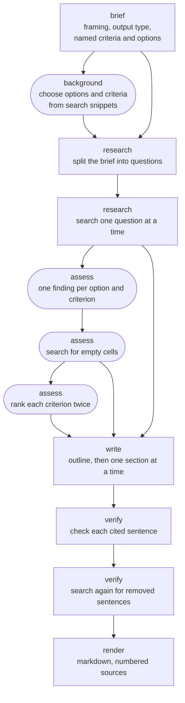
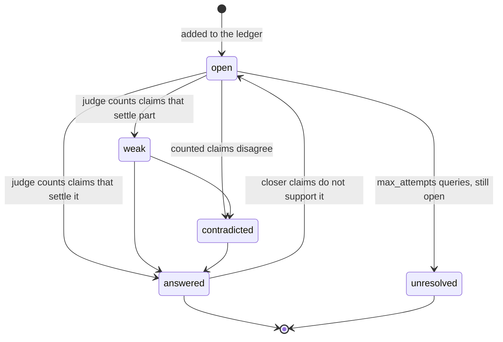
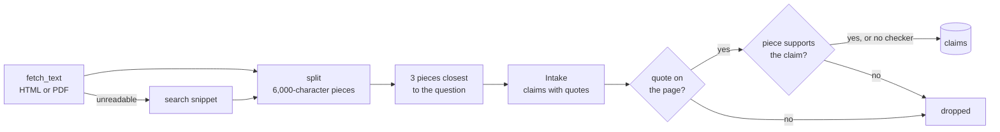
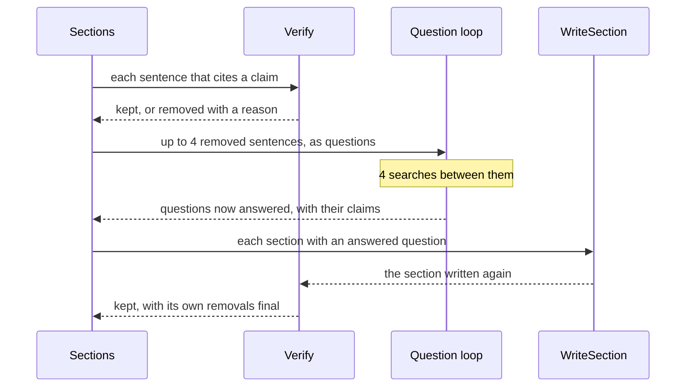

# The research pipeline

How the `ledger` method turns a question into a cited report, and why each step is shaped the way
it is. This page describes the pipeline as built: the `ledger` method in
`src/kvasir/methods/ledger/`, over the steps every method shares in `src/kvasir/research/`. How to
call it is in the README's [Research a question](../README.md#research-a-question). The plan it was
built from, with the sources behind each design rule, is
[`deep-research-plan.md`](deep-research-plan.md). How a run is streamed, accounted for and stored is
in [`architecture.md`](architecture.md).

## What it is built for

The pipeline targets a 27B-class model served locally, with a 16k context, by a server such as
Ollama that answers one request at a time. Four rules follow from that, and every step below
applies them.

| Rule | Consequence |
| --- | --- |
| Code decides how much to search and when to stop. The model decides what to search for, what a page says, and how to write it. | Budgets, stop conditions, query shapes and ranking arithmetic are constants in the modules of `methods/ledger/` and `research/`, not prompts. A prompted small model searches too little when left to decide. |
| No call sees more than one small input. | A page is cut into pieces of about 1,500 tokens, and each call reads one piece, one question and the brief. Nothing carries the run's history. |
| Nothing counts as evidence unless a page says it word for word. | Every claim carries a quote, and a claim whose quote is not on the page is dropped. Every cited sentence is later checked against those quotes. |
| Calls are sequential. | A local server answers one request at a time, so parallel model calls buy no speed. Only page downloads run in a pool. |

## The stages

Solid boxes run for every question. Rounded boxes run only for a `ranking` or a `table`. The stage
names are those the progress events and the run's timings use.

`rank` runs for a `ranking` only. A run whose research gathers no claim stops after the loop and
returns a report saying so, with no sections. A comparison whose background finds no options or no
criteria falls back to a `report`.

## Framing the question

`clarify` is a separate call, `POST /v1/clarify`, made before the run if the client wants
it. It asks at most three questions, or none. The answers travel with the research request, so the
API stays stateless.

`Brief` reads the question, the clarifications and today's date, and returns:

- a one-paragraph brief, which every later call reads;
- `assumptions`, every choice it made on the author's behalf, returned in the result;
- `output`: `ranking`, `table` or `report`;
- the criteria and the options the question names.

Today's date is passed because the model's sense of "now" is its training cutoff: without it,
"best" means best at that date.

The brief lists options from memory as readily as from the question. So a criterion or an option
counts as named only if `names` finds it in the question or its clarifications. `names` asks for
most of the words of a name, not all, since sources shorten names: "Qwen3-Coder-30B" for
"Qwen3-Coder-30B-A3B". Request fields `output`, `criteria` and `entities` override all of this.

### Choosing what to compare

For a ranking or a table, whatever the question left open is chosen from a first look at the web.
`PlanQueries` writes 3 queries (`BACKGROUND_QUERIES`), and their snippets, not their pages, become
the background. From it, `Criteria` picks up to `max_criteria` criteria weighted 1 to 3, and
`Entities` picks up to `max_entities` options. Criteria the question named weigh 1 each.

A small model fills a list with plausible names, such as model sizes never released, and searching
for those finds nothing. So an option the run chose is kept only if the background snippets name
it. The chosen options and criteria are then appended to the brief, which steers every later search
and every intake towards them.

## The question loop

The research is a ledger of questions, searched for one at a time. It works like an oral examiner:
a question the search leaves open is asked again in a different shape, and one it answers can add
harder follow-ups.

`Decompose` splits the brief into 3 to 6 questions, the ledger's first entries. It is told to ask
and not answer, since a fact it recalls wrongly would steer the search towards it.

The loop stops when any of these holds:

| Condition | Constant |
| --- | --- |
| `max_searches` searches are spent. | `KVASIR_RESEARCH_MAX_SEARCHES`, default 16 |
| No question is left to search for. | |
| 4 searches in a row add no claim. | `STALL_SEARCHES` |
| 3 searches in a row fail. The run then fails with `SearchUnavailable`, rather than write from no evidence. | `FAILED_SEARCHES` |

One empty search is the cue to try another shape, not to stop, which is why the stall limit waits
for several. A failed search costs budget but not an attempt at the question, since its query was
never answered.

### Picking, and judging first

`pick` takes the question with the fewest attempts, then the shallowest, then the oldest. Fewest
attempts first means every question gets a plain search before any gets a narrower one.

A search for one question often answers another. So before spending a search on a question, the
loop judges it again if claims arrived since its last judgement. A question already answered by
another search costs one judgement instead of a search.

### Picking by worth

With the option `frontier` set to `worth`, `methods/ledger/frontier.py` replaces `pick` for the
first pass of the loop. Filling cells and repairing sentences still search breadth first, since
their questions are set. A branch is a first question and its follow-ups.

- **Worth.** The question with the highest score goes next. The score is its cosine similarity to
  the brief, plus its distance from the closest claim held, plus 0.2 for a `weak` or
  `contradicted` question, less 0.15 per level of depth and 0.25 per query already tried. The
  weights are a first guess, not tuned.
- **Merging.** A new claim at a cosine similarity of 0.92 or more to one held (`DUPLICATE_CLAIM`)
  repeats it. From another site, it adds a source: its id goes in the held claim's
  `corroborated_by`. From the same site, it adds nothing. The repeat stays in `claims`, so it can
  still be cited.
- **Closing a branch.** A branch closes once 2 searches in a row on it (`BRANCH_STALL`) add no claim
  and no source, and none of its questions is searched again. The run-wide stall limit and budget
  still apply.

### Query shapes

The model writes the words of a query. The shape is chosen in code, by how many queries the
question has had:

| Attempt | Shape |
| --- | --- |
| 1 | General: the plain words someone would search for. |
| 2 | Specific: the exact terms, names, figures or year the answer would contain. |
| 3 | A primary source: `site:` and the official domain, or `filetype:pdf`. |
| 4 and later | A step back: the broader topic the answer sits in. |

`SearchFor` also reads the queries already tried and what the last judgement found missing. After
`max_attempts` attempts, an open question becomes `unresolved`. Whether `site:` and `filetype:`
work depends on the engines SearXNG uses.

### Judging a question

`CheckAnswer` reads the question and its 8 closest claims (`CLAIMS_PER_QUESTION`), each with its
quote. It counts a claim only if the quote states what the claim says, so a misquoted claim leaves
the question unanswered and the next search looks for it again. It returns a status, the claim ids
it counted, what is missing, and, for an answered question, up to two harder follow-ups.

`weak` and `contradicted` questions are still searched for while attempts remain. A verdict that
names no claim it was shown is treated as `open`, since a small model otherwise cites claims from
its own numbering. A question is not judged again when its closest claims are the ones it was last
judged on, since the verdict would not change.

Follow-ups apply only while `follow_ups` is on and the question is above `max_depth`. A follow-up
whose embedding is within 0.9 cosine similarity of a question already in the ledger is dropped
(`DUPLICATE_QUESTION`), and the ledger holds at most 24 questions (`MAX_QUESTIONS`): the budget
could not search for more.

## Reading a page

Each search keeps `results_per_query` results not read before in this run. Each page goes through
the same steps.

- **Fetch.** `fetch_text` downloads with `httpx` inside a process-wide fetch permit, for 20 seconds
  at most and 20 MB at most. HTML is reduced to visible text with BeautifulSoup, dropping scripts,
  styles, navigation, headers, footers, asides and forms. A PDF's text layer is read with `pypdf`,
  which is BSD-licensed and pure Python; PyMuPDF was ruled out as AGPL. A page that cannot be read
  (another format, a scanned or truncated PDF, an HTTP error) falls back to its search snippet.
  There is no OCR.
- **Split.** Pieces of at most 6,000 characters (`PIECE_CHARACTERS`), about 1,500 tokens, cut
  between lines. That leaves room in a 16k context for the brief, the instructions and the answer.
- **Filter.** Only the 3 pieces closest by embedding to the question (`PIECES_PER_PAGE`) are read.
  Closest to the question, not the brief: a page found for one narrow fact holds it in one piece,
  which the brief would not rank first.
- **Intake.** One fast-model call per piece. It reads the brief, the question the page was found
  for, the page title and the piece, and returns claims, each with a quote and a confidence.
- **Quote check.** `quoted` keeps a claim only if its quote appears in the piece word for word.
  The comparison is on words alone, lower-cased, so a non-breaking hyphen or a line break where the
  page had an inline tag does not count as a difference. An ellipsis in the quote stands for words
  left out, and the fragments must appear in order.
- **Grounding.** With the `ground` option and a checker configured, `research/ground.py` asks the
  checker whether the piece supports the claim, and drops the claim if not. The piece is the
  document rather than the quote, since a claim names what its quote leaves to the page, such as
  the subject of "it was found in 1904". A quote on the page shows the claim was read there, not
  that the page says it.

Intake is most of a run's calls: a search reads up to 3 pages of 3 pieces, so up to 9 intake calls.
Each piece is its own progress event, since the page being read is what a follower wants to see.

## Ranking and comparing

After the loop, a ranking or a table is filled in as a matrix: one row per option, one cell per
criterion.

1. **Assess.** For each cell, `Assess` reads the 8 claims closest to `option: criterion`
   (`CLAIMS_PER_CELL`) and writes a finding of at most six words with the claim ids it rests on.
   Only ids it was shown, of claims that name the option, are kept: a small model otherwise cites
   another option's figures for this one. A cell with no such claim is empty.
2. **Fill.** Each empty cell becomes a question in the ledger, "criterion of option", searched for
   by the same loop with its own budget of 8 searches (`FILL_SEARCHES`). Assessing the cell again is
   its judgement, so it costs no `CheckAnswer` call.
3. **Rank.** For a ranking only. On each criterion, the options with a finding are ranked by
   `RankCriterion` twice, the second time in reverse order, and each option takes the mean of its
   two places. Models favour what they read first, and reversing the order cancels that. Options
   with no finding tie for the places after them, since a judge asked to rank them anyway would
   guess.
4. **Aggregate.** The overall rank is the weighted mean of an option's criterion places, computed
   in code. A small model's absolute scores are unreliable, but its ordering is usable, so the
   model only ever orders.

The matrix is rendered by `render.matrix`, in code, and placed first in the report. Its cells cite
claims like the prose does.

## Writing

`Outline` reads the brief and the ledger rendered as notes (each question, its status, its claims
and what is missing), and returns 3 to 7 section titles in the shape the output type asks for:

| Output | Shape |
| --- | --- |
| `report` | Key findings first, then one section per part of the answer. |
| `ranking` | How the options were compared, then one section per option, best first. |
| `table` | A short summary of what the table shows, then at most two sections on what it leaves open. |

Sections are written in order, not in parallel, so a later section can avoid repeating an earlier
one. Each `WriteSection` call reads the brief, the outline, the first 400 characters of each
earlier section (`EARLIER_SECTION_CHARACTERS`), and the 15 claims closest to its title
(`CLAIMS_PER_SECTION`). It cites each factual sentence with claim ids such as `[3][7]`, and says
plainly what the evidence does not settle.

An "Open questions" section is added from the ledger: every first question, and every question that
was searched for, that did not end `answered`. Empty cells are left out, since the table shows them
as a dash.

## Verifying, and repairing

**Verify.** `research/verify.py` cuts each section into sentences and checks every sentence that cites
a claim. `Verify` reads the sentence and the cited claims with their quotes, and decides whether
every fact in the sentence is stated in the quotes or follows directly from them. An added number,
name or comparison makes it unsupported. An unsupported sentence is removed and recorded in
`removed`, with its section and the reason. Headings, tables and code are left alone, since a table
row is not a sentence and cutting one would break the table. A sentence citing nothing is left
alone too: it is a transition, or a statement that the evidence does not settle something. A
verdict that cannot be parsed keeps the sentence, since it says nothing about it.

With the `ground` option and a checker configured, a sentence citing one claim goes to the checker
instead, with the claim and its quote as the document. Only a sentence combining several claims
still goes to `Verify`, since the checker reads one document and one claim.

**Corroborate and contradict.** With `corroborate` or `contradict`, `research/corroborate.py` runs
after repair. Each claim is paired with up to 3 claims from other sites (`NEIGHBOURS`) at a cosine
similarity of 0.8 or more (`SAME_FACT`). Pages of one site, with `www.` dropped, are one source.
For each pair, the checker, or `Verify` without one, decides whether the other claim supports this
one; if so it goes in `corroborated_by`. Otherwise, with `contradict`, `Contradicts` decides whether
the two cannot both be true, and each goes in the other's `contradicted_by`. Both lists are data
for a reader and for the methods that weigh evidence; the ledger's report does not use them.

A small model cites claims that do not say what its sentence says. That is why every cited sentence
is checked, rather than trusting the writer.

**Repair.** A removed sentence is often true, cited to the wrong claim. Up to 4 removed sentences
(`REPAIR_SENTENCES`) become questions, judged by `CheckAnswer`, and the loop searches for them with
4 searches in all (`REPAIR_SEARCHES`). Each section with a question the search answered is written
again, with the claims that answer it added to its evidence, and verified again. This is one pass:
the rewritten section's own removals stand.

## Rendering

`render.render` joins the sections under `##` headings and turns claim ids into source numbers.
Sources are numbered by first citation, one number per page rather than per claim, so `[3][7]` from
the same page becomes one `[n]`. A marker naming a claim that does not exist is dropped: the model
made it up. Each citation carries the quote of the claim that first cited that page, which the runs
page shows on hover.

The `done` frame carries the report and everything needed to audit it: every claim with its quote
and URL, every question with its status and queries, and every removed sentence with its reason.
The full field list is in the README.

## Model roles

Each step has its own role in `runners._RESEARCH_ROLES`, so a run's usage splits by step.

| Role | Signature | Tier | Max tokens |
| --- | --- | --- | --- |
| `clarify` | `Clarify` | fast | 500 |
| `brief` | `Brief` | strong | 1000 |
| `decompose` | `Decompose` | strong | 600 |
| `plan` | `PlanQueries`, `SearchFor` | fast | 500 |
| `intake` | `Intake` | fast | 2000 |
| `check` | `CheckAnswer` | strong | 800 |
| `criteria` | `Criteria` | strong | 1000 |
| `entities` | `Entities` | strong | 600 |
| `assess` | `Assess` | fast | 600 |
| `judge` | `RankCriterion` | strong | 800 |
| `outline` | `Outline` | strong | 500 |
| `write` | `WriteSection` | strong | 2000 |
| `verify` | `Verify` | fast | 600 |
| `contradict` | `Contradicts` | fast | 400 |

The grounding checker is its own model, `KVASIR_MODEL_CHECKER`, with the role `ground`, 10 tokens
and temperature 0.

Signatures are typed dspy signatures: those every method shares in `research/signatures.py`,
`Clarify` in `research/clarify.py`, and the ledger's own in `methods/ledger/signatures.py`. dspy's
adapter turns each into a prompt and parses the answer back into its declared types, so no step
parses prose with a regex. A parse failure in intake, judging, assessing, ranking or verifying is
logged and treated as no result for that one call, rather than failing the run.

## What changed while building it

The pipeline first searched in rounds: each round planned 4 broad queries from rebuilt notes, and
the research stopped when a round added fewer than 5 claims. That missed facts only a specific
query finds, kept page pieces by closeness to the brief rather than to what the search was for,
and counted claims rather than what they answered. The question ledger replaced it (commit
`ff201b0`, a breaking change to the request fields). The plan's
[What the rounds get wrong](deep-research-plan.md#what-the-rounds-get-wrong) section lists each
problem and where it lived.

Two parts of this design have no source found applying them to research agents: tracking each
question's status, and sending verification failures back to the search. The plan marks both as
this design's own, to be kept or dropped on evidence.

## What is not measured yet

`python -m kvasir.research.evaluate` scores runs on 20 fixed questions in
[`eval/questions.toml`](../eval/questions.toml): the output type, a yes-or-no checklist per
question, and the citations that survived verification. How to run it is in the README's
[Evaluate research](../README.md#evaluate-research). The plan asked for a baseline from the rounds
before the question loop and the repair were built; they were built without one, so neither is yet
shown to beat what it replaced.

Deferred until there is an evaluation to prove them: thinking mode per step, `dspy.RLM` over the
evidence, a dedicated fact-checking model such as MiniCheck, and pairwise against listwise ranking.
