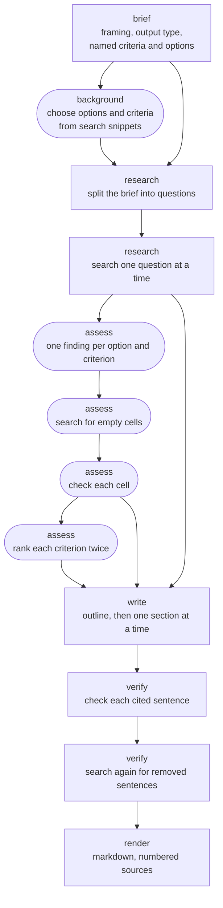
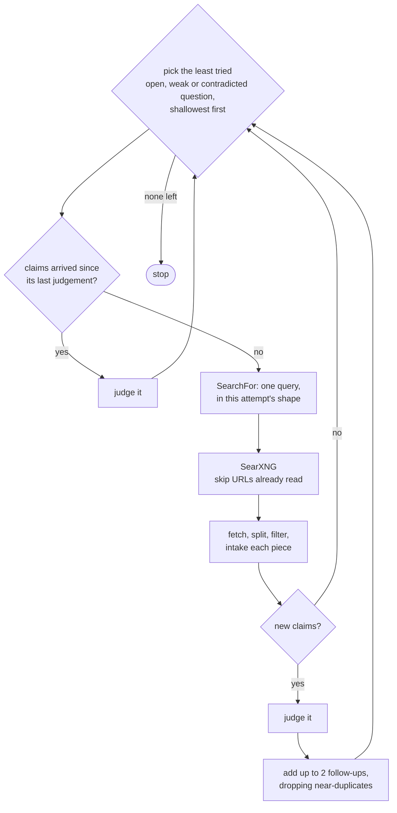
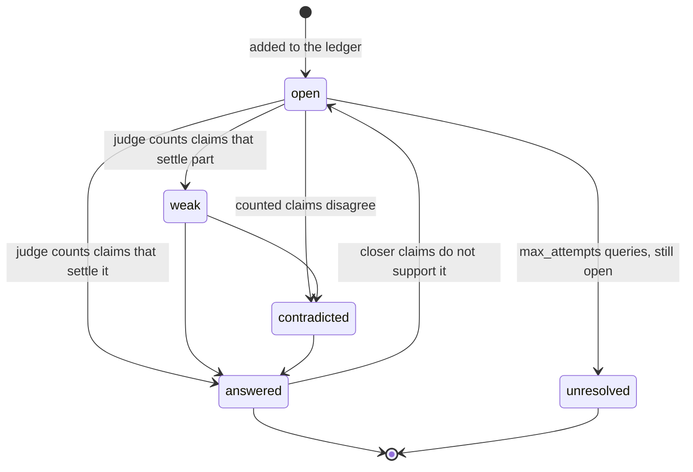
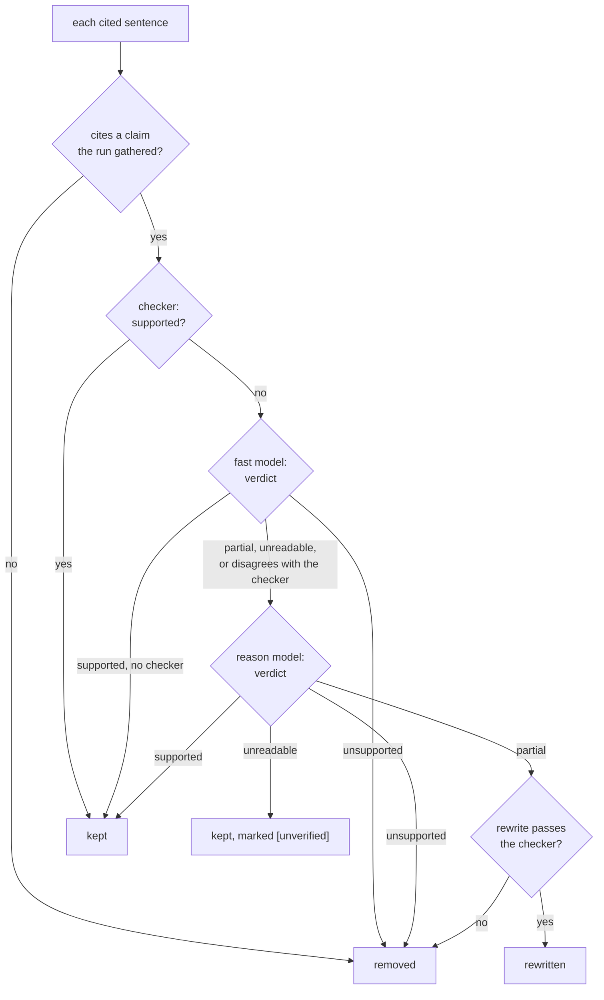

# The research pipeline

How the `ledger` method turns a question into a cited report, and why each step is shaped the way
it is. This page describes the pipeline as built: the `ledger` method in
`src/kvasir/methods/ledger/`, over the steps every method shares in `src/kvasir/research/`. How to
call it is in the README's [Research a question](../README.md#research-a-question). The plan it was
built from, with the sources behind each design rule, is
[`deep-research-plan.md`](deep-research-plan.md). How a run is streamed, accounted for and stored is
in [`architecture.md`](architecture.md).

## What it is built for

The pipeline targets a 27B-class model served locally, with a 16k context, by a server such as
Ollama that answers one request at a time. Four rules follow from that, and every step below
applies them.

| Rule | Consequence |
| --- | --- |
| Code decides how much to search and when to stop. The model decides what to search for, what a page says, and how to write it. | Budgets, stop conditions, query shapes and ranking arithmetic are constants in the modules of `methods/ledger/` and `research/`, not prompts. A prompted small model searches too little when left to decide. |
| No call sees more than one page. | A page is cut into pieces of about 1,500 tokens, and one call reads as many of its closest pieces as the context holds, with one question and the brief. Nothing carries the run's history. |
| Nothing counts as evidence unless a page says it word for word. | Every claim carries a quote, and a claim whose quote is not on the page is dropped. Every cited sentence is later checked against those quotes. |
| Calls are sequential, but for intake and downloads. | Intake calls run in a pool as wide as `KVASIR_MAX_THREADS`. A local server batches requests it holds at once, one pass over the weights serving each, so this is faster only when it holds several: for Ollama, set `OLLAMA_NUM_PARALLEL` to the same width. Each slot takes its own context's worth of memory. |

## The stages

Solid boxes run for every question. Rounded boxes run only for a `ranking` or a `table`. The stage
names are those the progress events and the run's timings use.



`rank` runs for a `ranking` only. A run whose research gathers no claim stops after the loop and
returns a report saying so, with no sections. A comparison whose background finds no options or no
criteria falls back to a `report`.

## Framing the question

`clarify` is a separate call, `POST /v1/clarify`, made before the run if the client wants
it. It asks at most three questions, or none. The answers travel with the research request, so the
API stays stateless.

`Brief` reads the question, the clarifications and today's date, and returns:

- a one-paragraph brief, which every later call reads;
- `assumptions`, every choice it made on the author's behalf, returned in the result;
- `output`: `ranking`, `table` or `report`;
- the criteria and the options the question names.

Today's date is passed because the model's sense of "now" is its training cutoff: without it,
"best" means best at that date.

The brief lists options from memory as readily as from the question. So a criterion or an option
counts as named only if `names` finds it in the question or its clarifications. `names` asks for
most of the words of a name, not all, since sources shorten names: "Qwen3-Coder-30B" for
"Qwen3-Coder-30B-A3B". Request fields `output`, `criteria` and `entities` override all of this.

### Choosing what to compare

For a ranking or a table, whatever the question left open is chosen from a first look at the web.
`PlanQueries` writes 3 queries (`BACKGROUND_QUERIES`), and their snippets, not their pages, become
the background. From it, `Criteria` picks up to `max_criteria` criteria weighted 1 to 3, and
`Entities` picks up to `max_entities` options. Criteria the question named weigh 1 each.

A small model fills a list with plausible names, such as model sizes never released, and searching
for those finds nothing. So an option the run chose is kept only if the background snippets name
it. The chosen options and criteria are then appended to the brief, which steers every later search
and every intake towards them.

## The question loop

The research is a ledger of questions, searched for one at a time. It works like an oral examiner:
a question the search leaves open is asked again in a different shape, and one it answers can add
harder follow-ups.

`Decompose` splits the brief into 3 to 6 questions, the ledger's first entries. It is told to ask
and not answer, since a fact it recalls wrongly would steer the search towards it.



The loop stops when any of these holds:

| Condition | Constant |
| --- | --- |
| `max_searches` searches are spent. | `KVASIR_RESEARCH_MAX_SEARCHES`, default 16 |
| No question is left to search for. | |
| 4 searches in a row add no claim. | `STALL_SEARCHES` |
| 3 searches in a row fail. The run then fails with `SearchUnavailable`, rather than write from no evidence. | `FAILED_SEARCHES` |

One empty search is the cue to try another shape, not to stop, which is why the stall limit waits
for several. A failed search costs budget but not an attempt at the question, since its query was
never answered.

### Picking, and judging first

`pick` takes the question with the fewest attempts, then the shallowest, then the oldest. Fewest
attempts first means every question gets a plain search before any gets a narrower one.

A search for one question often answers another. So before spending a search on a question, the
loop judges it again if claims arrived since its last judgement. A question already answered by
another search costs one judgement instead of a search. Then it recalls the pieces the run already
holds for the question (see "Recall and leads"), and a question recall answers costs no search.

### Picking by worth

With the option `frontier` set to `worth`, `methods/ledger/frontier.py` replaces `pick` for the
first pass of the loop. Filling cells and repairing sentences still search breadth first, since
their questions are set. A branch is a first question and its follow-ups.

- **Worth.** The question with the highest score goes next. The score is its cosine similarity to
  the brief, plus its distance from the closest claim held, plus 0.2 for a `weak` or
  `contradicted` question, less 0.15 per level of depth and 0.25 per query already tried. Its
  priority adds 0.2 for `core` and takes 0.2 for `peripheral` (`PRIORITY_BONUS`). The model that
  asks a question gives its priority, in `Decompose`, `Expand` or `Gaps`: `core` when the brief
  cannot be answered without it, `supporting` when it explains or qualifies the answer,
  `peripheral` for background. A word outside the three counts as `supporting`, and a follow-up is
  no more central than the question it follows up on. The weights are a first guess, not tuned.
- **Merging.** A new claim at a cosine similarity of 0.92 or more to one held (`DUPLICATE_CLAIM`)
  repeats it. From another site, it adds a source: its id goes in the held claim's
  `corroborated_by`. From the same site, it adds nothing. The repeat stays in `claims`, so it can
  still be cited.
- **Closing a branch.** A branch closes once 2 searches in a row on it (`BRANCH_STALL`) add no claim
  and no source, and none of its questions is searched again. The run-wide stall limit and budget
  still apply.

### The graph method

The `graph` method, in `methods/graph/`, keeps the ledger's brief, first questions, query shapes,
intake and verification, and the worth score and merging above, always on. It spends its effort
where questions are hard: a question answered on its first search costs one search and raises one
follow-up, while one that keeps coming back `weak` is searched again and split into children.

- **Time, not a count.** Research runs for `research_minutes` (20 by default) from the start of the
  run, then the report is written. `max_searches` is an optional cap on top, unset by default.
- **Pages.** A search reads up to `RESULTS_PER_QUERY` (5) pages, where the ledger reads 3, since
  the graph picks them through the fusion in [Reading a page](#reading-a-page). The graph does not
  read `research.results_per_query`; a run sets `results_per_query` to change it.
- **Gaps.** Once no question can still be settled and time is left, a `Gaps` call reads the brief
  and every question's name, text and status, and returns up to `GAP_QUESTIONS` (3) new first
  questions on what the report still lacks, each starting a new branch. The research ends early
  once `GAP_STALL` (2) gap calls in a row are dry: a call is dry when it adds no question, after
  the duplicate check and the `MAX_QUESTIONS` cap, or when the searches for what it added found
  fewer than `GAP_YIELD` (2) claims a search. Without gap calls, a live run ended at 8 of its 20
  minutes: its answered questions raised no follow-up and its other branches had closed. Without
  the yield check, a live run spent its last 9 minutes on niche questions that added few claims.
  Ending on one dry call, a live run stopped at 8 minutes on a single question that found nothing.
- **Picking: proof numbers.** `methods/graph/proof.py` applies proof-number search
  ([Allis 1994](https://en.wikipedia.org/wiki/Proof-number_search)). A question is settled either
  by a search for it or by settling every child it raised. Its work, the searches still needed, is
  0 once answered, 1 if never searched, `1 + attempts` for a retry, and the cheaper of a retry and
  the sum of its children's work when it has children. A question past `max_attempts`, or in a
  closed branch, never settles. The run takes the first question with the most worth per unit of
  work, then walks down it, stopping at a question whose retry costs less than its children, else
  moving to its child with the least work. A question searched once with two untried
  children costs 2 either way, and the tie goes to the children, so a new question is searched
  before its parent is tried again. A first question not answered after one search is searched
  again before the run goes two levels below any first question (`FIRST_SEARCHES`, 2): in a live
  run, one was left `weak` after one search while questions at depth 4 got 3 searches each.
- **Late in the research.** In the last `LATE_SHARE` (a quarter) of `research_minutes`, no question
  raises children and no gap call is made, since a question asked then would go unsearched. A first
  question that can still be settled is searched before any question below one, and the research
  ends once no question can still be settled.
- **Children: progressive widening.** After a search that adds claims, `Expand` judges the
  question on the claims it already rests on and the new ones, and asks one question per part of
  what is still missing. A question not answered, searched n times, may hold at most
  `ceil(WIDEN * n ** ALPHA)` children (2 and 0.5), and never more than `MAX_CHILDREN` (4), as in
  progressive widening for Monte Carlo tree search
  ([Couëtoux et al. 2011](https://juliapomdp.github.io/MCTS.jl/dev/dpw)). An answered question
  holds at most `FOLLOW_UPS` (1), a harder question taking the answer deeper, so the research
  does not end once the first questions are answered. Its work is that of its follow-ups, so the
  pick still reaches them; so is that of a question given up. Children are added while the
  question is above `max_depth` (4 by default), up to `MAX_QUESTIONS` (80) in the graph.
- **Settling up.** Once every child of a question is answered, `Expand` judges the question again
  on the claims its children rest on, without a search and without raising anything, and so on up
  the path.
- **Closing a branch.** As in the ledger, once `BRANCH_STALL` (2) searches in a row on it add no
  claim and no source. A rule from the marginal value theorem, closing a branch whose last 2
  searches added less than half of what a search of the run adds, was tried and dropped: in a live
  run it closed a branch whose first question found 4 claims and whose child found none, with 3
  retries of that question left.
- **Path, not ledger.** `Expand` reads the question's path from its first question, never the
  whole graph. So a question is not judged again on what another branch found, as the ledger's
  loop does.

The constants `WIDEN`, `ALPHA`, `MAX_CHILDREN`, `FOLLOW_UPS`, `GAP_QUESTIONS`, `GAP_STALL`,
`GAP_YIELD`, `FIRST_SEARCHES`, `LATE_SHARE`, `MAX_QUESTIONS`, `MAX_SECTIONS`, `OPEN_QUESTIONS` and the default depth and time are untuned first guesses, kept or changed on evaluation.

After the research, one `Outline` call reads each question with claims (its id, name, status,
claim count and what is missing) and groups them into three to seven sections under short
headings, ordered as the answer reads best, as STORM refines its outline from what its research
found. A section covering distinct parts gets two to four subsections, written as `###` headings.
A section is always given the claims its questions rest on. A repeated title adds to its first
section, and sections past `MAX_SECTIONS` (7) are dropped. A question with claims no section keeps
adds them to the section whose title is closest by embedding. When the outline cannot be read,
or names no question with claims, each branch is a section titled by its first question's name.

"Open questions" lists the first questions not answered, then the raised questions that ended
`weak` or `contradicted`, at most `OPEN_QUESTIONS` (10). A raised question the research found
nothing for was its own lead, not part of the brief, so it is left out. There is no repair pass. The design is untested against the ledger; see
[`methods-plan.md`](methods-plan.md#the-graph-method).

### Query shapes

The model writes the words of a query. The shape is chosen in code, by how many queries the
question has had:

| Attempt | Shape |
| --- | --- |
| 1 | General: the plain words someone would search for. |
| 2 | Specific: the exact terms, names, figures or year the answer would contain. |
| 3 | A primary source: `site:` and the official domain, or `filetype:pdf`. |
| 4 and later | A step back: the broader topic the answer sits in. |

`SearchFor` also reads the queries already tried and what the last judgement found missing. After
`max_attempts` attempts, an open question becomes `unresolved`. Whether `site:` and `filetype:`
work depends on the engines SearXNG uses.

### Judging a question

`CheckAnswer` reads the question and its 8 closest claims (`CLAIMS_PER_QUESTION`), each with its
quote. It counts a claim only if the quote states what the claim says, so a misquoted claim leaves
the question unanswered and the next search looks for it again. It returns a status, the claim ids
it counted, what is missing, and, for an answered question, up to two harder follow-ups.



`weak` and `contradicted` questions are still searched for while attempts remain. A verdict that
names no claim it was shown is treated as `open`, since a small model otherwise cites claims from
its own numbering. A question is not judged again when its closest claims are the ones it was last
judged on, since the verdict would not change.

Follow-ups apply only while `follow_ups` is on and the question is above `max_depth`. A follow-up
whose embedding is within 0.9 cosine similarity of a question already in the ledger is dropped
(`DUPLICATE_QUESTION`), and the ledger holds at most 24 questions (`MAX_QUESTIONS`): the budget
could not search for more.

## Reading a page

Before a question spends a search, the run recalls what it already holds (see "Recall and leads"
below). Each search then ranks the results not read before in this run, with the leads the pages
read so far left behind, and reads the first `results_per_query` of them: 3 in the ledger, 5 in
the graph. Each page goes through the same steps.

```mermaid
flowchart LR
    search["SearXNG results<br/>and leads"]
    pool["top 20 by<br/>SearXNG score"]
    fuse["fuse 3 rankings<br/>weighted RRF"]
    pick["pick results_per_query<br/>skip repeats"]
    fetch["fetch_page<br/>cache, HTML, browser, PDF"]
    snippet["search snippet"]
    split["split<br/>at headings"]
    filter["closest pieces<br/>PAGE_CHARACTERS"]
    pack["pack the pieces<br/>to fit the context"]
    intake["Intake<br/>claims with quotes"]
    quote{"quote on<br/>the page?"}
    ground{"piece supports<br/>the claim?"}
    store[("claims")]
    drop["dropped"]

    search --> pool --> fuse --> pick --> fetch
    fetch --> split
    fetch -- unreadable --> snippet --> split
    split --> filter --> pack --> intake --> quote
    quote -- yes --> ground
    quote -- no --> drop
    ground -- yes, or ground_intake off --> store
    ground -- no --> drop
```



- **Pick.** `research/search.py` sorts a query's unseen results by SearXNG's `score`, not by the
  order of the response, which SearXNG groups by category, and keeps the first `POOL` (20). It
  ranks them three ways: by SearXNG's score; by relevance, the cosine similarity between the
  question and the result's `title` and snippet; and by novelty, 1 less the highest cosine
  similarity to a claim the run holds. Novelty applies only when the run holds claims. The
  rankings are fused as `Σ w / (RRF_K + rank)`, with `RRF_K` 60 and weights
  `SEARXNG_WEIGHT` 1.0, `RELEVANCE_WEIGHT` 1.0 and `NOVELTY_WEIGHT` 0.5. The weights are a first
  guess, not tuned. Results are then taken best first, skipping one whose domain was already taken
  for the query, whose snippet has a cosine similarity above `NEAR_DUPLICATE` (0.9) to one
  taken, or whose site the run has read `PAGES_PER_SITE` (6) pages of, until `results_per_query`
  are taken. A skipped result is not marked seen, so a later search can take it. Without an
  encoder, as in the ledger's background search for `brief`, only the score order and the domain
  skip apply. The ledger passes the claims held by its frontier when it has one, and the graph
  always does.
- **Fetch.** `fetch_page` returns a `Page`: the URL asked for and the one that answered, title,
  text as markdown, the engine that read it (`static`, `render` or `stealth`), its links and when
  it was fetched. In order:
  1. **Cache.** A page in `pages.db` younger than `fetch.max_age_hours` (48) is returned with no
     request. An older one is asked for again with `If-None-Match` and `If-Modified-Since`, and a
     304 marks it fresh.
  2. **Static.** `httpx`, inside a process-wide fetch permit and at most `HOST_CONCURRENCY` (2)
     requests to one host at a time, `fetch.host_interval_seconds` (1.0) apart. For 20 seconds at
     most (`TIMEOUT_SECONDS`) and 20 MB at most (`MAX_BYTES`). A 429 waits out `Retry-After`, at
     most 30 seconds. The user agent names kvasir, its version and its repository, and
     `fetch.contact` when set, as Wikimedia's user-agent policy asks.
  3. **Check.** `check_page` refuses a challenge page (markers of Cloudflare, Akamai, DataDome,
     PerimeterX, Imperva, Sucuri and Kasada), a short block page, and an empty shell that only
     its scripts would fill.
  4. **Render.** With `fetch.render` `auto` and the `browser` extra installed, a refused page, or
     a 403 or 503, is loaded in Chromium through Playwright (`research/browser.py`), or Patchright
     with `fetch.stealth`. Images, media, fonts and ad hosts are not loaded. The `web-som` marking
     script hides cookie walls and overlays covering more than 80% of the page
     (`MAX_COVER_RATIO`) before the HTML is read. The rendered page is checked again.
  5. **Extract.** HTML becomes markdown with trafilatura, footnote markers such as `[12]` and
     `[edit]` removed. When trafilatura returns under `MIN_TEXT` (200) characters, the page is
     cleaned instead: scripts, menus, buttons, dialogs and other interactive parts are dropped by
     selector and the visible text kept. Links are read before cleaning, each with its anchor, the
     200 characters around it and its region: `main`, `related` (an `aside`, a "See also" or
     "Related articles" block), `nav` or `footer`.

  A PDF's text layer is read with `pypdf`, which is BSD-licensed and pure Python; PyMuPDF was
  ruled out as AGPL. A page that cannot be read (another format, a scanned or truncated PDF, an
  HTTP error, a challenge with no browser) falls back to its search snippet. There is no OCR. A
  claim read from the snippet has `from_snippet` set: the snippet is the search engine's summary
  of the page, not the page. A lead that cannot be read gives nothing, since its snippet is what
  another page said about it.
- **Split.** `split` cuts the text at its headings, merging sections while they fit and never
  across a top-level one, into pieces of at most 6,000 characters (`PIECE_CHARACTERS`), about
  1,500 tokens. A section that does not fit is cut between paragraphs. Each piece starts with the
  headings above it, so a piece read alone still says what it is about, and a quote from it is
  still on the page. The size is set by the embedding filter, not the reading model:
  `nomic-embed-text` was trained on 2,048 tokens, and a longer piece would be ranked on less than
  all of it.
- **Filter.** Every piece is encoded with the page title before it, and goes into the run's corpus.
  The pieces closest by embedding to the question are read, as many as `PAGE_CHARACTERS` (18,000
  characters, three full pieces) holds, in page order. Closest to the question, not the brief: a
  page found for one narrow fact holds it in one piece, which the brief would not rank first. With
  `nomic-embed-text`, the encoder prefixes the question `search_query: ` and each piece
  `search_document: `, as the model was trained to read them; texts compared with each other,
  such as two questions, all take the document prefix. The search ranking above encodes the
  question the same way.
- **Pack.** The kept pieces of a page are joined in page order, marked apart by `[...]`, into as
  few texts as fit one call (`pack`). A call holds `page_characters(context_tokens)` characters:

  ```text
  (context_tokens - PROMPT_TOKENS - context_tokens / 4) * MARGIN * CHARACTERS_PER_TOKEN
  ```

  The context is `KVASIR_MODEL_CONTEXT_TOKENS` (16384 by default), the window the models are served with.
  The prompt besides the page is `PROMPT_TOKENS` (1,000), the answer gets a quarter of the
  context, `MARGIN` is 0.9 and `CHARACTERS_PER_TOKEN` is 3.5. The 47 intake calls of one run on
  gpt-oss came to 34 + characters / 4.07 prompt tokens, with about 600 for the prompt besides the
  page, and answers of at most about 500 tokens for one piece. Each constant is rounded towards a
  smaller page, since a token holds fewer characters in figures, PDFs and other languages. At
  16384 a call holds 35,557 characters, so the pieces kept from a page are read in one call.
- **Intake.** One fast-model call per packed text, the calls of a search running side by side. It
  reads the brief, the question the page was found for, the page title and the text, and returns
  claims, each with a quote and a confidence. Claims are numbered in page order once read.
- **Quote check.** `quoted` keeps a claim only if its quote appears in the piece word for word.
  The comparison is on words alone, lower-cased, so a non-breaking hyphen or a line break where the
  page had an inline tag does not count as a difference. An ellipsis in the quote stands for words
  left out, and the fragments must appear in order.
- **Qualifier check.** `misleading` drops a claim whose quote the page turns around: "grows"
  quoted from "it never grows" is on the page and means the opposite. The quote is dropped when
  either of the 2 words just before it in its sentence on the page, or any word an ellipsis stands for, is one of
  `QUALIFIERS` in `research/text.py` (`not`, `no`, `never`, `unless`, `if`, `except`, `without`,
  `only`, `cannot`) or a negative contraction such as "isn't".
- **Grounding.** With the `ground_intake` option and a checker configured, `research/ground.py` asks the
  checker whether the piece its quote is in supports the claim, and drops the claim if not. The
  piece is the document rather than the quote, since a claim names what its quote leaves to the page, such as
  the subject of "it was found in 1904". A quote on the page shows the claim was read there, not
  that the page says it. The claims of a search are checked once all its pages are read, so on a
  GPU that cannot hold the checker beside the fast model, the two swap twice a search rather than
  once a page. The option is off by default, since even that adds two model loads to each search.

Intake is most of a run's calls: a search reads up to 3 pages in the ledger and 5 in the graph, one
call each at the default context. Each call is its own progress event once it returns, since the
page read is what a follower wants to see.

The methods behind picking:

| Method | What it does | Use here |
| --- | --- | --- |
| Reciprocal Rank Fusion (Cormack, Clarke and Büttcher, SIGIR 2009) | Combines rankings with `score = Σ w_i / (k + rank_i)`, k = 60. It uses ranks only, so no score scaling is needed | Merges SearXNG's order with kvasir's own |
| CombSUM / CombMNZ (Fox and Shaw 1994) | Adds normalized scores; MNZ multiplies by how many systems found the result | SearXNG's `score` already does this across engines |
| Embedding similarity of the snippet | Cosine between the question and `title + snippet`, with the encoder kvasir already uses | kvasir's relevance ranking |
| MMR (Carbonell and Goldstein 1998) | Picks greedily by `λ·relevance − (1−λ)·max similarity to what is already held or picked` | Avoids pages that repeat claims the run already has; kvasir uses the cheap form: novelty as a ranking, plus a near-duplicate and domain skip |

### Recall and leads

A run keeps every piece of every page it reads in its corpus (`research/corpus.py`), with the
vector the filter computed, and marks the pieces intake read. Before a question is searched, both
loops recall: the unread pieces closest to the question, at most `RECALL_PIECES` (3), at a cosine
similarity of at least `RECALL_MIN` (0.6), at most `RECALL_PER_SITE` (2) from one site. Intake
reads them as it reads a page, under the `intake` role, and the question is judged on what they
give. An answer costs no search. Recall does not count against the search budget, and a question is
recalled for again only once the corpus has grown.

Recall also reaches `pages.db`, which keeps the pieces of every run with the embedding model that
encoded them. FTS5 ranks the cached pieces by the question's words (BM25), the top 200 of the
current model are compared by vector, and the same rules apply. A page cached by an earlier run can
answer with no search and no download. The `recall_past_runs` option set to `false` keeps recall
to the run's own pages. The cache still serves downloads and still keeps the run's pieces.

A run does not crawl. The links of each page read, from its text and its related blocks but never
its menus or footer, stay behind as leads, at most `LEADS_PER_PAGE` (20) a page and at most
`LEAD_DEPTH` (2) links from a search result. A lead is encoded once from its anchor, the text around
it and its URL path, and scored for each search:

```text
worth = relevance + NOVELTY_WEIGHT * novelty + AFFINITY_WEIGHT * affinity + RELATED_BONUS
```

Relevance is its cosine similarity to the question, and a lead under `LEAD_MIN` (0.5) is not a
candidate. Novelty is as for a search result. Affinity is its site's claims that another site
corroborated, per page of the site read, so it is 0 without corroboration: under the `breadth`
frontier of the ledger. `RELATED_BONUS` (0.1) is for a link in a related block. Leads join the search's pool,
ranked by worth where a result is ranked by SearXNG's score, and at most `LEADS_PER_QUERY` (2) are
picked a search. A lead is read only once `allowed` passes: its host resolves to public addresses
only, since a page chose the URL, and the site's `robots.txt`, kept a day, lets it be read. A
`robots.txt` that is missing or answers 4xx allows everything; one that answers 5xx or not at all
refuses, a lead costing little to skip. A search result is not checked against `robots.txt`.

A site whose affinity reaches `SITE_AFFINITY` (1.0) earns a site search: for a question already
searched once, the query is `site:<domain> <question>` in place of the planner's, once a question
and site. The weights and thresholds of this section are first guesses, not tuned.

## Ranking and comparing

After the loop, a ranking or a table is filled in as a matrix: one row per option, one cell per
criterion.

1. **Assess.** For each cell, `Assess` reads the 8 claims closest to `option: criterion`
   (`CLAIMS_PER_CELL`) and writes a finding of at most six words with the claim ids it rests on.
   Only ids it was shown, of claims that name the option, are kept: a small model otherwise cites
   another option's figures for this one. A cell with no such claim is empty.
2. **Fill.** Each empty cell becomes a question in the ledger, "criterion of option", searched for
   by the same loop with its own budget of 8 searches (`FILL_SEARCHES`). Assessing the cell again is
   its judgement, so it costs no `CheckAnswer` call.
3. **Rank.** For a ranking only. On each criterion, the options with a finding are ranked by
   `RankCriterion` twice, the second time in reverse order, and each option takes the mean of its
   two places. Models favour what they read first, and reversing the order cancels that. Options
   with no finding tie for the places after them, since a judge asked to rank them anyway would
   guess.
4. **Aggregate.** The overall rank is the weighted mean of an option's criterion places, computed
   in code. A small model's absolute scores are unreliable, but its ordering is usable, so the
   model only ever orders.

The matrix is rendered by `render.matrix`, in code, and placed first in the report. Its cells cite
claims like the prose does.

## Writing

`Outline` reads the brief and the ledger rendered as notes (each question, its status, its claims
and what is missing), and returns 3 to 7 section titles in the shape the output type asks for:

| Output | Shape |
| --- | --- |
| `report` | Key findings first, then one section per part of the answer. |
| `ranking` | How the options were compared, then one section per option, best first. |
| `table` | A short summary of what the table shows, then at most two sections on what it leaves open. |

Sections are written in order, not in parallel, so a later section can avoid repeating an earlier
one. Each `WriteSection` call reads the brief, the outline, the first 400 characters of each
earlier section (`EARLIER_SECTION_CHARACTERS`), and the 15 claims closest to its title
(`CLAIMS_PER_SECTION`). It cites each factual sentence with claim ids such as `[3][7]`, and says
plainly what the evidence does not settle.

Its style rules are adapted from [stop-slop](https://github.com/hardikpandya/stop-slop): lead with
the finding, name the actor, prefer the evidence's numbers and names, and leave out filler
openers, rhetorical setups, rhythmic triplets, inflated words and em dashes. It bolds the one or
two key terms of a paragraph, and may add one callout: `> [!WARNING]` for disputed evidence,
`> [!CAUTION]` for a likely misreading, `> [!IMPORTANT]` for the point a section turns on, or
`> [!NOTE]` for context. A small model breaks such rules anyway, so `research/style.py` then takes
out what it can without touching a fact: filler openers such as "Notably," and "It is important to
note that", intensifiers such as "very" and "really", and em dashes, which become commas, or an en
dash between numbers. Text in double quotes and code is left as written.

Once the sections are written, one `Summarize` call reads the start of each, as much as the
context holds shared between them, and returns three to five cited points, the answer first. They
are checked with the sections, and become the report's TL;DR.

In the ledger, an "Open questions" section is added: every first question, and every question that
was searched for, that did not end `answered`. Empty cells are left out, since the table shows them
as a dash.

## Verifying, and repairing

A small model cites claims that do not say what its sentence says. That is why every cited
sentence is checked, rather than trusting the strong model. The check is a cascade: cheaper steps
go first, and only the sentences they leave in doubt reach a dearer model. A sentence ends at
`kept`, `rewritten`, `removed` or `kept, marked [unverified]`.



`research/verify.py` cuts each section into sentences and runs every sentence that cites a claim
through the cascade. Each step runs over all the sentences before the next begins, since the
checker and the fast model share one local server and alternating between them would load a model
for each sentence.

1. **Citation.** A sentence citing no claim the research gathered is removed.
2. **Checker.** With the `ground` option and a checker configured, the checker is shown the claims
   the sentence cites with their quotes, joined as the document. A sentence it supports is kept.
   Without a checker, this step is skipped.
3. **Fast model.** `Verify` reads the sentence and the cited claims with their quotes, and returns
   `supported`, `partial` or `unsupported`, with a reason. Every fact stated in the quotes, or
   following directly from them, is supported. A sentence that adds a number, name or comparison
   beside facts the quotes state is partial. `unsupported` removes the sentence. `supported` keeps
   it when there is no checker; with one, the fast model disagrees with the checker, and the
   sentence goes on. `partial`, and a verdict that cannot be parsed, go on too.
4. **Reason model.** `Escalate`, on the `escalate` role, returns the same verdict and, for a
   partial sentence, a rewrite that states only what the quotes say and cites only the claims the
   sentence already cited. It keeps a supported sentence and removes an unsupported one. A verdict
   it cannot give leaves the sentence in, marked `[unverified]`.
5. **Rewrite.** A rewrite must pass the checker, or `Verify` without one, or the sentence is removed
   instead. A rewrite that is empty or cites another claim also removes it.

Each removed sentence is recorded in `removed` with its section, the reason and the `stage` that
removed it: `citation`, `verify`, `escalate` or `rewrite`. A rewritten sentence goes in
`revised`, with its section, the sentence before and after, and the reason. A sentence left
`[unverified]` goes in `unverified`, with its section and the reason. Bold is taken out of the
sentence before it is checked. A callout keeps its surviving sentences, and goes when none is
left. Headings, tables and code are left alone, since a table row is not a sentence and cutting
one would break the table. A sentence citing nothing is left alone too: it is a transition, or a
statement that the evidence does not settle something. The checker runs only once the report is
written, so it is loaded once per run.

**Cells.** In a ranking or a table, the ledger's cells go through the same cascade, in the
`assess` stage, after the empty cells are searched for and before ranking. Each cell with a finding
is checked against the claims it cites, all cells together so each model loads once. A cell the
cascade removes, or finds partly supported, is emptied: a cell is at most six words, so it is not
rewritten. It ties for last when ranked, like any cell no claim spoke to. An unverified cell keeps
its finding, marked `[unverified]`. Both are recorded under the table's title in `removed` and
`unverified`.

**Corroborate and contradict.** With `corroborate` or `contradict`, `research/corroborate.py` runs
after repair. Each claim is paired with up to 3 claims from other sites (`NEIGHBOURS`) at a cosine
similarity of 0.8 or more (`SAME_FACT`). Pages of one site, with `www.` dropped, are one source.
For each pair, the checker, or `Verify` without one, decides whether the other claim supports this
one; if so it goes in `corroborated_by`. Then, with `contradict`, each pair in which neither claim
supports the other is asked once whether the two cannot both be true, and each goes in the other's
`contradicted_by`. `Contradicts` asks about all of one claim's pairs in one call, and the calls run
side by side, `max_threads` at a time. Support is decided for every pair before any disagreement:
the checker and the fast model rarely fit in memory together, and alternating between them would
load a model for each pair. Both lists are data for a reader and for the methods that weigh
evidence; the ledger's report does not use them.

**Repair.** A removed sentence is often true, cited to the wrong claim. Up to 4 removed sentences
(`REPAIR_SENTENCES`) become questions, judged by `CheckAnswer`, and the loop searches for them with
4 searches in all (`REPAIR_SEARCHES`). Each section with a question the search answered is written
again, with the claims that answer it added to its evidence, and verified again through the same
cascade. This is one pass: what that check did to the rewritten section's sentences replaces what
the first check did, and its own removals stand.

## Rendering

`render.render` joins the sections under `##` headings and turns claim ids into source numbers. The
summary goes first, as a `> [!SUMMARY] TL;DR` callout. With 3 sections or more
(`CONTENTS_SECTIONS`), a `> [!ABSTRACT] Contents` callout follows, a nested list linking each `##`
and `###` heading by the anchor GitHub gives it. Callouts are GitHub and Obsidian syntax: the runs
page draws them as tinted boxes, and a renderer without them, such as Open WebUI, shows a quote
starting with `[!SUMMARY]`.
Sources are numbered by first citation, one number per page rather than per claim, so `[3][7]` from
the same page becomes one `[n]`. A marker naming a claim that does not exist is dropped: the model
made it up. Each citation carries the quote of the claim that first cited that page, which the runs
page shows on hover.

The `done` frame carries the report and everything needed to audit it: every claim with its quote
and URL, every question with its status and queries, every removed sentence with its reason and the stage that removed it, every sentence rewritten
to its quotes, and every sentence left unverified.
The full field list is in the README.

## Model roles

Each step has its own role in `runners._RESEARCH_ROLES`, so a run's usage splits by step.

| Role | Signature | Tier | Max tokens |
| --- | --- | --- | --- |
| `clarify` | `Clarify` | fast | 500 |
| `brief` | `Brief` | strong | 1000 |
| `decompose` | `Decompose` | reason | 2000 |
| `plan` | `PlanQueries`, `SearchFor` | fast | 500 |
| `intake` | `Intake` | fast | 2000 |
| `check` | `CheckAnswer` | reason | 2500 |
| `criteria` | `Criteria` | reason | 3000 |
| `entities` | `Entities` | reason | 2000 |
| `assess` | `Assess` | fast | 600 |
| `judge` | `RankCriterion` | reason | 2500 |
| `outline` | `Outline` | strong | 2500 |
| `write` | `WriteSection` | strong | `context_tokens` - 4000 |
| `tldr` | `Summarize` | strong | 2000 |
| `verify` | `Verify` | fast | 600 |
| `contradict` | `Contradicts` | fast | 600 |
| `escalate` | `Escalate` | reason | 2500 |

The outline, the sections and the summary use the strong model. They run only after the research,
so a strong model too large to share memory with the fast model is loaded once.

The reason tier serves the roles that judge rather than extract or write. `KVASIR_MODEL_REASON`
sets its model, and unset it falls back to the strong model. It has its own
`KVASIR_MODEL_REASON_EFFORT`, `medium` by default, which replaces `KVASIR_MODEL_REASONING_EFFORT`
for this tier: these roles are meant to think. Thinking counts against `max_tokens`, so their
budgets are about three times what the answer needs. Without `reason` set, these roles therefore
run on the strong model, at effort `medium` and with the larger budgets. A `ledger` or `graph`
request can override the model with `model_reason`.

With the reason model on a cloud provider, each escalated sentence and its quotes are sent to that
provider. `KVASIR_RUNS_KEEP_CALL_CONTENT` governs only what kvasir stores, not this.

The grounding checker is its own model, `KVASIR_MODEL_CHECKER`, with the role `ground`, 10 tokens
and temperature 0.

Signatures are typed dspy signatures: those every method shares in `research/signatures.py`,
`Clarify` in `research/clarify.py`, and the ledger's own in `methods/ledger/signatures.py`. dspy's
adapter turns each into a prompt and parses the answer back into its declared types, so no step
parses prose with a regex. A parse failure in intake, judging, assessing, ranking or verifying is
logged and treated as no result for that one call, rather than failing the run.

## What changed while building it

The pipeline first searched in rounds: each round planned 4 broad queries from rebuilt notes, and
the research stopped when a round added fewer than 5 claims. That missed facts only a specific
query finds, kept page pieces by closeness to the brief rather than to what the search was for,
and counted claims rather than what they answered. The question ledger replaced it (commit
`ff201b0`, a breaking change to the request fields). The plan's
[What the rounds get wrong](deep-research-plan.md#what-the-rounds-get-wrong) section lists each
problem and where it lived.

Two parts of this design have no source found applying them to research agents: tracking each
question's status, and sending verification failures back to the search. The plan marks both as
this design's own, to be kept or dropped on evidence.

## What is not measured yet

`python -m kvasir.research.evaluate` scores runs on 20 fixed questions in
[`eval/questions.toml`](../eval/questions.toml): the output type, a yes-or-no checklist per
question, and the citations that survived verification. How to run it is in the README's
[Evaluate research](../README.md#evaluate-research). The plan asked for a baseline from the rounds
before the question loop and the repair were built; they were built without one, so neither is yet
shown to beat what it replaced.

Deferred until there is an evaluation to prove them: thinking mode per step, `dspy.RLM` over the
evidence, a dedicated fact-checking model such as MiniCheck, and pairwise against listwise ranking.
