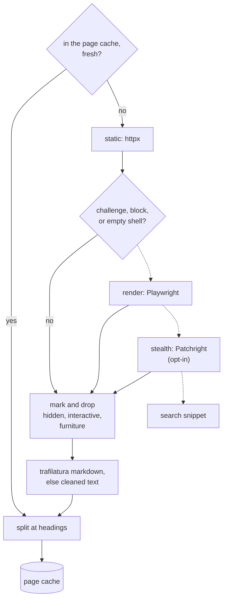

# Reading the web: plan

Status: built 2026-11-04, tasks T1 to T13 and T15 to T16; T14, the evaluation, is not run. What is
built is described in [`research.md`](research.md#reading-a-page) and
[`architecture.md`](architecture.md#what-is-kept-and-where), which are the reference; this page
keeps the reasons. Supersedes open decision 1, page text extraction, of
[`deep-research-plan.md`](deep-research-plan.md#open-decisions): intake did read menus and buttons.

Built differently from the plan below:

- One browser step, not two. `fetch.stealth` swaps Playwright for Patchright in the render step
  rather than adding a step above it.
- `playwright` and `patchright` are the `browser` optional dependency (an extra), not a dependency
  group, so `uv sync --extra browser` and the Docker `browser` target install them.
- The filter keeps as many pieces as `PAGE_CHARACTERS` (18,000 characters) holds, not 3 pieces:
  pieces cut at headings are smaller than the old 6,000-character ones.
- A lead's host must resolve to public addresses before it is read, since the page chose its URL,
  and `robots.txt` is read again after 24 hours.
- The page cache has no site name, date or heading-path columns; nothing reads them yet.
- T14 has no baseline from before T3, so it can compare only against later changes.

This plan changes how a run reads a page, remembers it, and goes from one page to the pages it
links to. The pipeline it changes is described in [`research.md`](research.md#reading-a-page). It
adds no model call and no model role: every new step is code or the embedding model, and intake,
judging and writing keep their roles and tiers.

## What is wrong now

| Symptom | Cause | Where |
| --- | --- | --- |
| Intake reads buttons, menus, cookie banners and share widgets. | `extract` drops eight tag names, then takes `get_text` of the rest. Nothing scores the main content, and no class or id is looked at. | `research/fetch.py` `extract` |
| A page fetched for one question is lost to the next. | `relevant_pieces` encodes every piece of a page and keeps 3. The URL is then in `seen`, which `search` skips for the rest of the run. | `research/read.py`, `research/search.py` |
| Nothing survives the run. | Pages are not stored; a run keeps only its claims, in its result. | `docs/architecture.md`, "What is kept" |
| A page that needs JavaScript reads as its empty shell, and a challenge page reads as content. | `fetch_text` makes one `httpx` request and extracts whatever came back. A 404 page with status 200 is extracted too. | `research/fetch.py` `fetch_text` |
| A run never goes from a good page to the related pages it links to. | Links are discarded with the markup. | `research/fetch.py` |

Measured on 2026-11-04, with `extract` against `trafilatura.extract(output_format="markdown",
include_tables=True, include_comments=False, favor_recall=True)` on the same downloads. A line under
25 characters is nearly always a button, a menu entry or a label.

| Page | `extract`: lines, of which short | trafilatura: lines, of which short |
| --- | --- | --- |
| `en.wikipedia.org/wiki/Roman_Empire` | 15,212, 13,143 | 1,047, 64 |
| `docs.python.org/3/library/sqlite3.html` | 5,727, 4,858 | 1,395, 342 |
| `www.worldhistory.org/Roman_Empire/` | 419, 244 | 54, 7 |
| `arstechnica.com/science/` (a listing page) | 270, 191 | 222, 147 |

trafilatura keeps Wikipedia's footnote markers as `<sup>\[a\]</sup>`, so its output needs a
cleanup pass. A listing page stays mostly short lines either way, which is what it is.

## Design rules, and the evidence behind them

Confidence follows [`deep-research-plan.md`](deep-research-plan.md#design-rules-and-the-evidence-behind-them):
"high" is a primary source read in full, "medium" a primary source read through a summary, "low" a
secondary source or a fragment.

| Rule | Evidence | Confidence |
| --- | --- | --- |
| Extract main content with trafilatura, and fall back to a selector-cleaned page when it returns too little. | trafilatura 2.3.0 scores F 0.926 on its 990-page benchmark (2026-10-02), readability-lxml 0.853, jusText 0.862 ([evaluation](https://trafilatura.readthedocs.io/en/latest/evaluation.html)). Bevendorff et al. (SIGIR 2023) also rank it first on mean, with no extractor best on every page ([benchmark](https://github.com/chatnoir-eu/web-content-extraction-benchmark)). The table above. | medium; high for the table |
| No model cleans a page. | ReaderLM-v2 is CC-BY-NC-4.0 ([card](https://huggingface.co/jinaai/ReaderLM-v2)). MinerU-HTML is Apache-2.0 and 0.6B ([repo](https://github.com/opendatalab/MinerU-HTML)), but it would be a model call per page on the GPU intake already uses. Kept as a later experiment. | medium |
| Clean by selectors as well as by tags. | Firecrawl's `onlyMainContent` is a blacklist of about 48 CSS selectors (`.cookie`, `.modal`, `.popup`, `.overlay`, `.menu`, `.breadcrumbs`, `.share`, `.social`, `.ad`, `[aria-label="Cookie consent" i]`, challenge iframes) with a whitelist that spares any element holding `#main`, and no scoring (`apps/api/src/scraper/scrapeURL/lib/removeUnwantedElements.ts`, `apps/api/native/src/html.rs`). It retries with the full page when main content comes back empty. | medium |
| Strip interactive elements. | `web-som`'s `SELECTORS` (`src/constants.ts`) lists what a page offers to click or fill: `button`, `input`, `select`, `textarea`, `[role=button]`, `[role=menuitem]`, `[role=tab]`, `[role=option]`, `[role=switch]`, `.btn` and others. Their text is the button noise. Links are kept, since they are content and leads. | high |
| Render a page in a browser only when its static HTML says it needs one. | Firecrawl decides by request flags, not by a detector, and its Playwright service waits for `load`, blocks media and 13 ad domains, and blocks service workers (`apps/playwright-service-ts/api.ts`). Crawl4AI flags an empty shell when HTML under 50 KB has two of: visible text under 50 characters, no content element, scripts but under 100 characters of text (`crawl4ai/antibot_detector.py`). | medium |
| Recognise a challenge or block page, and never extract it as content. | Crawl4AI's `antibot_detector.py` markers by vendor (Cloudflare `__cf_chl_f_tk=`, `/cdn-cgi/challenge-platform/`; Akamai `Pardon Our Interruption`; DataDome `captcha-delivery.com`; Imperva `_Incapsula_Resource`; PerimeterX `window._pxAppId=`). FlareSolverr's titles (`Just a moment...`, `DDoS-Guard`, `Access denied`, `Attention Required! \| Cloudflare`) and selectors (`#cf-challenge-running`, `#challenge-spinner`, `#turnstile-wrapper`) (`src/flaresolverr_service.py`). | medium |
| Get through a challenge only when the operator turns it on. | Patchright (Apache-2.0) is a drop-in for Playwright's API. FlareSolverr (MIT) runs `undetected_chromedriver` head-full under Xvfb, waits for the challenge markers to clear, and returns the cookies, which work only with its own user agent; its README says none of its captcha solvers work. Getting past a challenge can break a site's terms, which is the operator's call. | medium |
| Say who is asking, outside the stealth tier. | Wikimedia wants `<client>/<version> (<contact>) <library>/<version>` and may refuse a generic one with 403. Such a client gets 200 requests a minute, and 10 without it; on a 429, wait for `Retry-After` or at least 5 seconds ([policy](https://foundation.wikimedia.org/wiki/Policy:Wikimedia_Foundation_User-Agent_Policy), [limits](https://www.mediawiki.org/wiki/Wikimedia_APIs/Rate_limits)). | high |
| Split a page at its headings, then merge small sections up to the piece size. | A benchmark of 36 strategies over 6 domains found structure-aware and paragraph-group chunks well ahead of fixed-size ones ([arXiv 2603.06976](https://arxiv.org/abs/2603.06976)). Vectara found fixed-size ahead of semantic chunking ([arXiv 2410.13070](https://arxiv.org/abs/2410.13070)). Neither tests headings against fixed windows directly. | low |
| Embed each piece with its page title and heading path. | Anthropic's contextual retrieval: adding a chunk's context before embedding cut failed top-20 retrievals from 5.7% to 3.7% ([post](https://www.anthropic.com/engineering/contextual-retrieval)). It writes that context with a model; the heading path is a free stand-in, untested. | medium |
| Keep every piece of a page read, and look there before searching. | IterResearch and WebWeaver keep evidence in a store retrieved on demand, not in the context ([IterResearch](https://arxiv.org/html/2511.07327v2), [WebWeaver](https://arxiv.org/pdf/2509.13312)). Neither paper measures refetching. | medium |
| Store pages, not memories, and not a knowledge graph. | Graph memories run a model over every document to index it: about 6k tokens a document for HippoRAG 2 and 40k for GraphRAG ([arXiv 2607.11683](https://arxiv.org/pdf/2607.11683)). Injected memories succeed over 95% of the time against agents that store what they read as facts ([MINJA](https://arxiv.org/abs/2503.03704)). A page stored with its URL and fetch time is evidence, re-read under each run's own checks. | medium |
| Keep a cached page 2 days, and revalidate it after. | Firecrawl's `maxAge` defaults to 172,800,000 ms ([docs](https://docs.firecrawl.dev/features/fast-scraping)). | high |
| Code ranks the links; the model never picks one. | Jina found LLMs pick URLs near-randomly, and ranks them in code: `hostnameBoost + pathBoost + freqBoost + 0.8 × reranker score`, at most 2 a host, and an in-page link weighs 0.1 against 1 for a search hit (`src/utils/url-tools.ts`, `src/agent.ts` in node-DeepResearch). WebWalker's small models gave up after a few clicks ([arXiv 2501.07572](https://arxiv.org/html/2501.07572)). | medium |
| Score a link on its anchor and the text around it, against what the run still needs. | Shark-search scores a link by its anchor and a window around it, plus its page's relevance ([survey](https://arxiv.org/pdf/0906.5034)). Crawl4AI scores a link `0.5 × relevance + 0.3 × novelty + 0.2 × authority`, with novelty the share of its terms not yet seen, and its URL scorers read the URL string only (`crawl4ai/adaptive_crawler.py`, `crawl4ai/deep_crawling/scorers.py`). | medium |
| Bound link following by depth and per site. | Crawl4AI's adaptive crawl follows 3 links a page, 20 pages at most, and stops below a gain of 0.1. WebWalker allows 15 actions. Jina keeps 2 URLs a host. | medium |

Not settled by any source: whether Parsoid HTML from `/w/rest.php/v1/page/{title}/html` extracts
better than the rendered Wikipedia page, how trafilatura does on forums, and late chunking, which
needs token-level embeddings that Ollama does not return.

## Reading a page

A page goes up a ladder of engines and stops at the first that yields text. Solid arrows are the
usual path; dotted ones run only when the step before fails its check.



- **Static.** As now, with a user agent that names kvasir, its version and the operator's contact
  from `fetch.contact`. A conditional GET when the cache holds a stale copy with an ETag or a
  Last-Modified date; a 304 refreshes the copy.
- **Check.** A challenge or block page, from the markers above, goes up the ladder or, at the top,
  to the snippet. So does an empty shell. A 4xx after redirects is a failure, not a page.
- **Render.** One Chromium per process, a context per host so cookies persist within the run, `load`
  then at most 2 seconds for the network to go quiet, media, fonts and ad hosts blocked, service
  workers blocked. A script derived from `web-som` marks the elements to drop: those under
  `VISIBILITY_RATIO` visible, those covering more than `MAX_COVER_RATIO` of the viewport (the cookie
  wall), and the interactive ones. The marked DOM is serialized and goes through the same
  extraction as a static page. `fetch.render = "auto"` uses it when the check asks for it and the
  `browser` extra is installed; `"off"` never does.
- **Stealth.** With `fetch.stealth = true` only. The same steps through Patchright, with the
  browser's own user agent, and the challenge cookies kept per host for the run. Never in a
  default config.
- **Clean.** For a static page, the same three rules by selector on the parsed HTML: Firecrawl's
  blacklist with its `#main` whitelist, `web-som`'s interactive selectors, and the eight tags
  dropped now. Links are read before anything is dropped, so links in a dropped "related" box still
  become leads.
- **Extract.** trafilatura's markdown, footnote markers removed. When it returns under
  `MIN_TEXT` characters (200, untuned) the cleaned page's text is used, as Firecrawl retries the
  full page. The quote check in `research/text.py` compares words only, so markdown syntax does not
  break it; links are left out of the text so that a URL's words never become part of a quote.
- **Split.** At headings, then small sections under one parent merged up to `PIECE_CHARACTERS`, and
  a section over it cut between paragraphs. Each piece carries its heading path. The embedding sees
  `title > path` and the piece; intake sees the same.

PDFs keep `pypdf` and their fallback to the snippet.

## Remembering what was read

### Within a run: the corpus

Every piece of every page read goes into the run's corpus with its vector, which `read` already
computes and throws away. The corpus records which pieces intake has read. It holds the links of
each page as leads, and how well each site has done: its pages read, and its claims kept and
corroborated.

Before a question spends a search, the run recalls the unread pieces of the corpus closest to it:
at most `RECALL_PIECES` (3), at a cosine similarity of at least `RECALL_MIN` (0.6, untuned), at
most 2 from one site. Intake reads them as it reads a page. If claims arrive, the question is
judged, and a question that comes back `answered` costs no search at all. Recall does not count
against the search budget; it is bounded by the pieces left. Both the ledger loop and the graph
method's explore loop recall, through one function in `research/`.

### Across runs: the page cache

`$KVASIR_DATA_DIR/pages.db`, a SQLite file of its own, so that deleting it loses nothing else.

| Table | Holds |
| --- | --- |
| `pages` | normalized URL, final URL, fetch time, ETag, Last-Modified, content hash, engine, title, site name, date, text |
| `pieces` | page, position, heading path, text, embedding model, vector as `float32` bytes; an FTS5 index over the text |
| `links` | page, target URL, anchor, surrounding text, region (`main`, `related`, `nav`, `footer`) |

It holds public pages only: no brief, question or claim, since those carry what a user asked. One
cache serves every user of the service. A page is fresh for `fetch.max_age_hours` (48), then
revalidated. A vector from another embedding model is ignored, and the piece re-encoded.

Recall reaches the cache too. FTS5 ranks the cached pieces by the question's words (BM25), the top
200 are compared by vector, and the corpus's own rules apply, so a page cached last week can answer
a question with no search and no download. A claim read from a cached page cites the page with the
date it was fetched.

URLs are normalized before any lookup. `courlan.normalize_url(url, strict=True)`, from a
trafilatura dependency, lowercases the host and drops the fragment and tracking parameters such as
`utm_source`. Code then collapses `www.`, the scheme, a trailing slash and `index.html`, and keeps
`#/` and `#!/` routes, which name a page in a single-page app.

### Choosing, per run, what the cache gives

Two run options, as Firecrawl's `maxAge` is a request option. Recall within the run is always on,
since it only reuses what the run itself read.

| Option | Default | Effect |
| --- | --- | --- |
| `recall_past_runs` | `true` | `false`: recall searches only the run's own corpus. The cache still serves downloads, so a page is not fetched twice. |
| `max_age_hours` | `fetch.max_age_hours` | `0`: every page is fetched again and its cached copy replaced. |

Both are request fields of the `ledger` and `graph` methods, `Settings` fields in the settings
modal, and fields of the launch form.

### The knowledge page

A page of the dashboard, `#/knowledge`, shows what the cache holds. It is also where extraction is
checked: the text shown is the text intake reads.

| View | Shows |
| --- | --- |
| Sites | Each domain with its pages, pieces, last fetch, and the engines that read it. |
| Page | URL, fetch time and age, engine, the extracted markdown by section, its leads by region, and the stored runs that cite it. |
| Recall | A question box returning the pieces recall would take, with their similarity, to tune `RECALL_MIN` on. |
| Actions | Delete a page or a site, fetch a page again. |

Its API: `GET /v1/pages?site=`, `GET /v1/pages/{id}`, `GET /v1/pages/recall?q=`,
`DELETE /v1/pages/{id}`, `DELETE /v1/sites/{domain}`, `POST /v1/pages/{id}/refetch`. Like every
route of the service, these have no authentication (see `kvasir.api`), so anyone who can reach the
service can empty the shared cache.

## Leads: estimating what a linked page holds

A run does not crawl. Each page read leaves its links behind as leads, and a lead is followed only
when it looks worth more than the next search result. In the case this is for: a search on the
Roman Empire lands on an article whose "related articles" box lists six more. Those six become
leads, scored against every question still open, and the ones that match a question get read
before a search result that only repeats what the run holds.

A lead's worth for a question is computed in code from one embedding of `anchor`, the 200
characters around the link and the URL path's words, encoded once when the page is read:

```text
worth = relevance + NOVELTY_WEIGHT × novelty + AFFINITY_WEIGHT × affinity + region
```

- **relevance**: cosine similarity of the lead to the question. Every open question is scored, not
  only the one the page was found for, which is how a page found for one question feeds another.
- **novelty**: 1 less the highest similarity of the lead to a claim held, as `search` computes it
  for a result.
- **affinity**: the site's claims kept and corroborated by another site, over its pages read, in
  this run. A site whose pages keep giving claims that other sites confirm is a site worth reading
  more of.
- **region**: a bonus for a link in a `related`, "See also" or "Further reading" block, none for one
  in the text, and no lead at all from `nav` or `footer`.

Leads join a question's search results as candidates, the anchor as title and the surrounding text
as snippet, and the fusion in `search` ranks them with the rest; worth stands in for SearXNG's
score, which a lead does not have. A run follows at most `LEADS_PER_QUERY` (2) a search, to a depth
of `LEAD_DEPTH` (2) links from a search result, and reads at most `PAGES_PER_SITE` (6) pages from
one site. `robots.txt` applies to leads, which are the run's own navigation; a search result is
fetched as now. The weights are a first guess.

A site with high affinity also earns a site search: one SearXNG query `site:<domain> <question>`,
counted as a search, for a question still open. It finds what the site has on the question even
when no page read so far links to it, as Firecrawl's `/map` uses a `site:` search.

### Why this narrows the risk

Reading more from sites whose claims others confirm keeps a report's citations on fewer, checked
sources, rather than a fresh set of unknown sites for each question. Two limits keep it from
leaning on one site: `PAGES_PER_SITE`, and corroboration, which still counts only other sites.
Affinity is counted per run, from that run's checks, so one run's sources never vouch for another
run's.

## Settings

| Setting | Default | Variable |
| --- | --- | --- |
| `fetch.render` | `auto` | `KVASIR_FETCH_RENDER` |
| `fetch.stealth` | `false` | `KVASIR_FETCH_STEALTH` |
| `fetch.contact` | empty: no contact in the user agent | `KVASIR_FETCH_CONTACT` |
| `fetch.max_age_hours` | 48 | `KVASIR_FETCH_MAX_AGE_HOURS` |
| `fetch.host_interval_seconds` | 1.0 | `KVASIR_FETCH_HOST_INTERVAL_SECONDS` |

Constants stay constants in their modules, as the research pipeline's do.

## Dependencies

| Package | License | Why |
| --- | --- | --- |
| `trafilatura==2.3.1` | Apache-2.0 | Main-content extraction and markdown. Brings `lxml` (BSD-3-Clause), `courlan` and `htmldate` (Apache-2.0), `justext` (BSD-2-Clause), `charset_normalizer`, `certifi` (MPL-2.0) and `urllib3`. |
| `playwright` | Apache-2.0 | The render engine, in a `browser` extra so the default image does not carry Chromium. |
| `patchright` | Apache-2.0 | The stealth engine, in the same group. |

`beautifulsoup4` stays for the cleaned fallback and the link reader. The Docker image gains a
`browser` target on `mcr.microsoft.com/playwright/python`, run with `--init` and `--ipc=host`, as
Playwright's Docker docs require against Chromium running out of shared memory.

## Build order

Each task is sized for one implementing agent with the task text, the files it names, and this
page. Each ends with `uv run pytest`, `uv run ruff check .`, `uv run ruff format --check .` and `uv run mypy` passing and its own test
added. Tasks in one wave touch different files and can run side by side; a wave starts once the one
before it is reviewed.

| Wave | Task | Files | Done when |
| --- | --- | --- | --- |
| 1 | **T1 Page fixtures.** About 8 saved pages under permissive licenses (Wikipedia, Python docs, MDN, a docs site) plus 3 written by hand: a cookie wall with a modal, a page of buttons and tabs, an empty SPA shell, and one challenge page per vendor marker. Each has strings that must and must not survive extraction. | `tests/fixtures/pages/`, `tests/test_fetch.py` | The tests run, and the current `extract` fails the "must not" checks it is expected to fail. |
| 1 | **T2 Host politeness.** A per-host minimum interval and at most 2 requests at once a host, `Retry-After` on 429, and the user agent from `fetch.contact`. `robots.txt` waits for T12, its only caller. | `storm/runtime.py`, `config.py`, `kvasir.example.toml` | Unit tests with a fake clock and fake hosts. |
| 2 | **T3 Extraction.** trafilatura markdown with the footnote cleanup, the selector clean as fallback under `MIN_TEXT`, and the check for challenge, block, empty-shell and 4xx pages. Add the dependency. | `research/fetch.py`, `pyproject.toml`, `uv.lock` | T1 passes; a quote from a markdown table or list still passes `quoted`. |
| 3 | **T4 Pages and links.** `fetch_page` returns a `Page`: final URL, title, text, engine, links with anchor, surrounding text and region, read before cleaning, normalized with `courlan`. `fetch_text` goes, its callers and the tests that patch it move to `fetch_page`. | `research/fetch.py`, `research/read.py`, `tests/test_ledger.py`, `tests/test_research.py` | A fixture's "related" links come back as `related` and its menu as `nav`. |
| 3 | **T5 Render engine.** Playwright behind `fetch.render`, the `web-som` marking script, then the same extraction; Patchright behind `fetch.stealth`. The `browser` extra and Docker target. | new `research/browser.py`, `pyproject.toml`, `Dockerfile` | The SPA fixture, served locally, extracts its text rendered and not static; an integration test, skipped without Chromium. |
| 4 | **T6 Sections.** Split at headings, merge and cut as above, heading paths on pieces and in the embedding input. | `research/fetch.py` `split`, `research/read.py` | No piece spans two top-level sections; every piece is at most `PIECE_CHARACTERS`. |
| 5 | **T7 Corpus and recall.** The run's corpus, `recall`, read marks, site counts. `read` adds every page's pieces. | new `research/corpus.py`, `research/read.py` | Unit tests for recall's threshold, site cap and read marks. |
| 5 | **T8 Page cache.** `pages.db`, its three tables and FTS5, fresh, stale and revalidated reads, vectors keyed by model. | new `research/pages.py`, `config.py` | A second fetch of a URL makes no request; a stale one makes a conditional one; a 304 refreshes it. |
| 6 | **T9 Recall in the ledger.** Recall before each search, intake, judgement, a search saved on `answered`, a `recall` progress event. | `methods/ledger/loop.py`, `runs/progress.py` | With fake models, a second question answered from the first's page makes no search. |
| 6 | **T10 Recall across runs.** Recall reaches the cache through FTS5 then vectors. | `research/corpus.py`, `research/pages.py` | A second run answers a question from the first run's page with no fetch. |
| 7 | **T15 Run options.** `recall_past_runs` and `max_age_hours` as request fields, `Settings` fields and launch-form fields. | `methods/ledger/method.py`, `methods/graph/method.py`, `schemas/requests.py`, `web/src/components/Settings.svelte`, `web/src/pages/NewRun.svelte` | With `recall_past_runs` false, the T10 test makes its search; with `max_age_hours` 0, a cached URL is fetched again. |
| 7 | **T11 Recall in the graph.** As T9, for the explore loop. | `methods/graph/explore.py` | The T9 test, for the graph method. |
| 7 | **T12 Leads.** Lead worth, leads in the search pool, the depth and site limits, `robots.txt` on leads, the site search on high affinity. | `research/search.py`, `research/corpus.py` | A fake run follows a page's related link that matches an open question, skips its menu, and stops at `PAGES_PER_SITE`. |
| 8 | **T16 Knowledge page.** The API routes above and `web/src/pages/Knowledge.svelte`, its route and a nav link in `web/src/App.svelte`. | new `api/pages.py`, `api/app.py`, `web/src/pages/`, `web/src/App.svelte`, `web/src/lib/` | API tests over a seeded `pages.db`; `pnpm check` and an e2e test against the mock. |
| 9 | **T13 Documentation.** "Reading a page" and "Model roles" in `research.md`, "What is kept" in `architecture.md`, the settings in the README, and this page's status. | `docs/`, `README.md` | Every constant and setting named matches the code. |
| 9 | **T14 Evaluation.** `python -m kvasir.research.evaluate` before T3 and after T12, comparing judge checks passed, searches, downloads, cache and recall hits, claims kept, and distinct sites cited. | `research/evaluate.py` | A run against the live gateway and SearXNG; it cannot run in CI. |

Not planned, until T14 shows the need: Parsoid HTML for Wikipedia, MinerU-HTML, sitemap and
`llms.txt` reading, `sqlite-vec` in place of FTS5 and numpy, and site affinity kept across runs.
